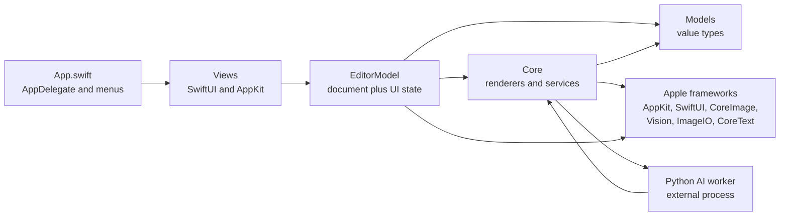
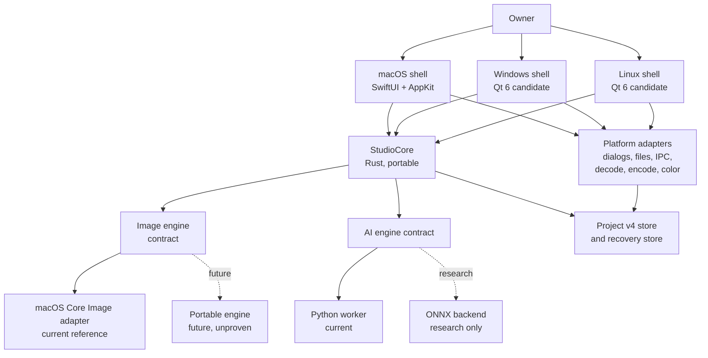
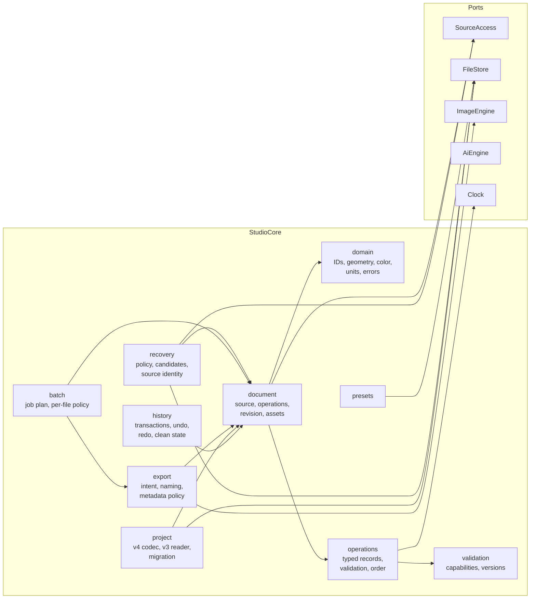
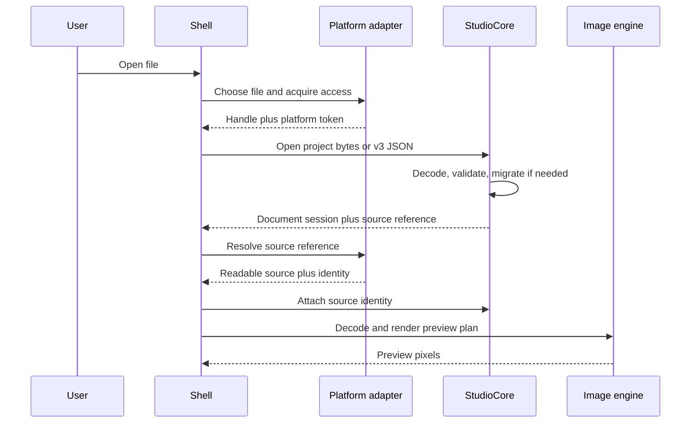
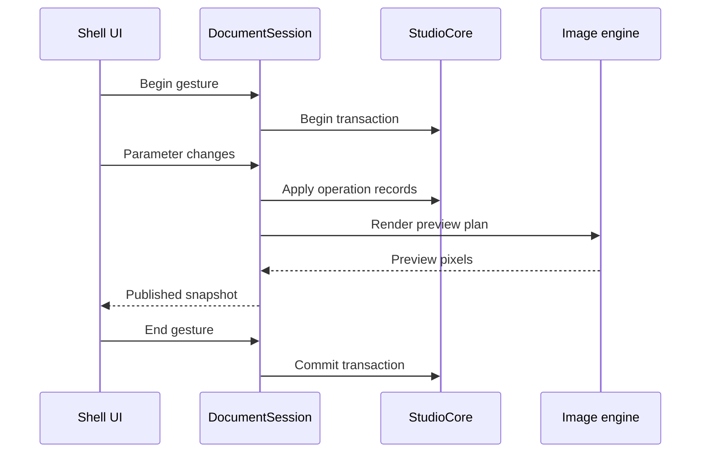
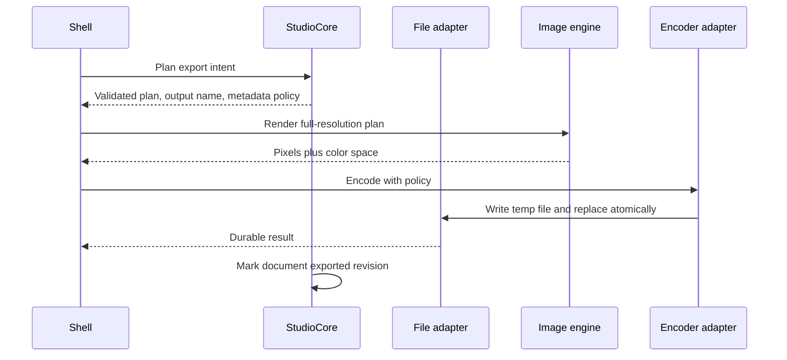
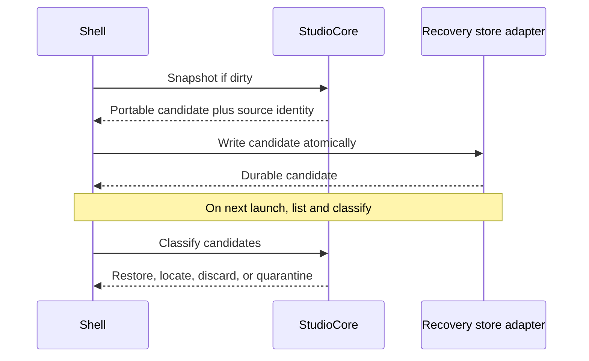
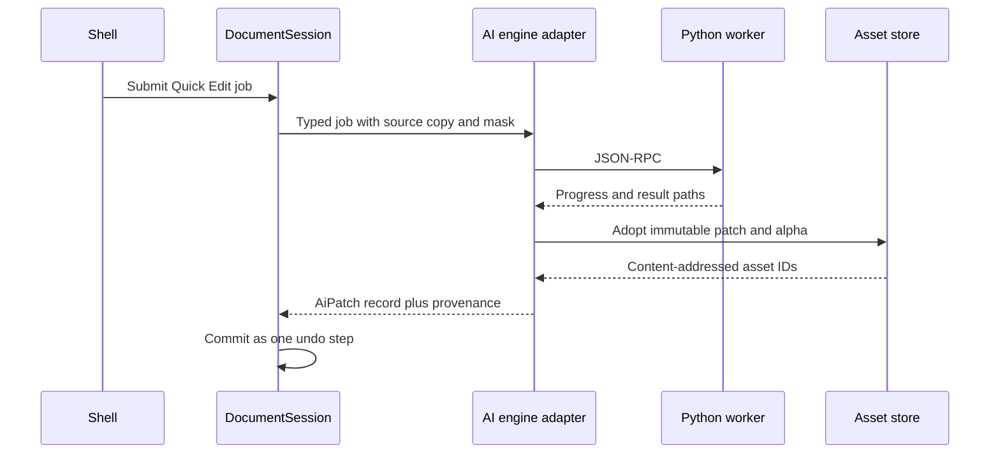

# StudioCore — Target Architecture

**Status:** Design deliverable, not implemented
**Milestone:** 4 — StudioCore Architecture & Extraction Design
**Repository:** `/Users/roham/RetouchStudio`
**Baseline branch / commit:** `main` / `7cfc8594f416c987386e0abe103cc75121de073a`
**Date:** 2026-11-11
**Companions:** [STUDIOCORE_INTERFACE_DESIGN.md](STUDIOCORE_INTERFACE_DESIGN.md), [CROSS_PLATFORM_TECHNOLOGY_DECISIONS.md](CROSS_PLATFORM_TECHNOLOGY_DECISIONS.md), [STUDIOCORE_EXTRACTION_ROADMAP.md](STUDIOCORE_EXTRACTION_ROADMAP.md)

---

## 0. Reading guide and evidence labels

This document describes a target architecture for a platform-independent `StudioCore`. It is grounded in the repository at the commit above. It does not authorize implementation.

Every substantive claim carries one of these labels:

| Label | Meaning |
|---|---|
| **VERIFIED** | Read directly from source, tests, build scripts, or repository documents at this commit. File and line references are given. |
| **RECOMMENDATION** | A design choice proposed by this milestone, with its rationale and alternatives. Not implemented. |
| **HYPOTHESIS — NOT VERIFIED** | A plausible expectation that requires a prototype, measurement, or owner decision. It must not be presented as fact. |
| **PROPOSED** | Schema or interface text that is an interface draft, not an existing contract. |

The existing macOS application remains the quality reference and must remain shippable throughout. Nothing in this document replaces the current image engine, project format, recovery store, AI runtime, or UI.

---

## 1. Verified starting state

**VERIFIED.** The working tree was clean, the branch was `main`, `HEAD` was `7cfc8594f416c987386e0abe103cc75121de073a`, and `origin/main` pointed at the same commit when this design was written. The four reference documents were read in full:

- `Docs/PHASE0_CROSSPLATFORM_AUDIT.md` — current inventory, blockers, technology classifications, roadmap (`Docs/PHASE0_CROSSPLATFORM_AUDIT.md:1`).
- `Docs/GOLDEN_IMAGE_CORPUS.md` — fixtures, baselines, determinism, coverage gaps (`Docs/GOLDEN_IMAGE_CORPUS.md:1`).
- `Docs/IMAGE_ENGINE_CHARACTERIZATION.md` — pipeline order, masks, operation matrix, exports, non-captured areas (`Docs/IMAGE_ENGINE_CHARACTERIZATION.md:1`).
- `Docs/IMAGE_COMPARISON_METHODOLOGY.md` — canonical pixels, metrics, gates, invalidation (`Docs/IMAGE_COMPARISON_METHODOLOGY.md:1`).

The audit already classifies the choices this milestone elaborates:

- Rust for `StudioCore` — **Confirmed recommendation** (`Docs/PHASE0_CROSSPLATFORM_AUDIT.md:286`).
- Rust for the portable image engine — **Needs a technical prototype** (`Docs/PHASE0_CROSSPLATFORM_AUDIT.md:287`).
- Swift for the macOS shell — **Confirmed recommendation** (`Docs/PHASE0_CROSSPLATFORM_AUDIT.md:288`).
- Qt 6/QML for Windows/Linux — **Needs a technical prototype** (`Docs/PHASE0_CROSSPLATFORM_AUDIT.md:301`).
- v4 directory package — **Confirmed recommendation**, schema still to be designed (`Docs/PHASE0_CROSSPLATFORM_AUDIT.md:346`).

This document accepts those classifications. It does not upgrade any "needs a prototype" item to "confirmed".

---

## 2. Current architecture map

### 2.1 One flat compilation unit

**VERIFIED.** The app is compiled by `build.sh` as a single Swift module: `SOURCES=$(find Sources -name '*.swift')` and one `swiftc` invocation per architecture (`build.sh:58`, `build.sh:60-66`). There is no Swift package, no module target, and no enforced import boundary. Every type in `Sources/RetouchStudio` can see every other type. The test harness does the same: it links the whole tree except `App.swift` and `SelfCheck.swift` (`Tests/run.sh:35`, `Tests/run.sh:51-54`).

Consequences:

- A type cannot be moved to a portable target without first removing its accidental access to UI and Apple types.
- The compiler cannot tell us whether a type is portable. Import review must do that work.
- The current tests are valuable characterization tests, but they link the app, so they cannot prove that a future StudioCore builds without AppKit/SwiftUI.

### 2.2 Size and coupling

**VERIFIED.** The audit records 78 Swift files / 36,653 lines, with `EditorModel` at 3,518 lines and 92 `@Published` properties (`Docs/PHASE0_CROSSPLATFORM_AUDIT.md:142`, `Docs/PHASE0_CROSSPLATFORM_AUDIT.md:154`). The count is confirmed by `grep -c "@Published"` at `Sources/RetouchStudio/Models/EditorModel.swift` (92).

`EditorModel` is simultaneously:

| Responsibility | Evidence |
|---|---|
| Document state and published UI mirror | `Sources/RetouchStudio/Models/EditorModel.swift:16-196` |
| Operation coordination and busy gating | `Sources/RetouchStudio/Models/EditorModel.swift:234-306` |
| Undo/redo snapshots and 350 ms gesture coalescing | `Sources/RetouchStudio/Models/EditorModel.swift:313-366` |
| Load/open/project lifecycle, including `NSOpenPanel` | `Sources/RetouchStudio/Models/EditorModel.swift:841`, `:900`, `:963`, `:3017`, `:3133` |
| Export orchestration and snapshot capture | `Sources/RetouchStudio/Models/EditorModel.swift:3028` |
| Project creation and atomic JSON write | `Sources/RetouchStudio/Models/EditorModel.swift:3144`, `:3163-3168` |
| Batch export orchestration and per-file task | `Sources/RetouchStudio/Models/EditorModel.swift:3329`, `:3426` |
| Recovery lifecycle glue | `Sources/RetouchStudio/Models/Recovery.swift:181-342` |
| AI sheet state, mask tools, Quick Edit invocation | `Sources/RetouchStudio/Models/EditorModel.swift:139-196`, `Sources/RetouchStudio/Models/QuickEdit.swift:89` |

The file imports AppKit, Combine, CoreGraphics, CoreImage, SwiftUI, and UniformTypeIdentifiers (`Sources/RetouchStudio/Models/EditorModel.swift:1-6`). It is therefore not a portable document object; it is the macOS presentation controller for a document.

### 2.3 Real dependency directions

**VERIFIED.** The dependency flow is not layered today. It is bidirectional:

- `EditorModel` (in `Models/`) calls `ImageProcessor`, `ExportService`, `WorkerClient`, and `AIRuntime` (in `Core/`).
- `Core/ExportService.swift` uses document value types such as `Adjustments`, `HealSpot`, `Sticker`, `AIEdit`, and `AnalysisSettings` (in `Models/`).
- `ImageProcessor` uses `HealSpot` and the pipeline parameter types (in `Models/`).
- `FaceAnalyzer` (in `Core/`) defines `FaceGeometry`, which the UI and `EditorModel` consume directly (`Sources/RetouchStudio/Core/FaceAnalyzer.swift:12`).

The result is a `Models ↔ Core` cycle at the folder level. The folders are organizational only; the compiler does not enforce them.



### 2.4 Apple framework leakage

**VERIFIED.** Framework imports inside `Models/` and `Core/` are not confined to one adapter layer:

| File | Imports |
|---|---|
| `Sources/RetouchStudio/Models/EditorModel.swift` | AppKit, Combine, CoreGraphics, CoreImage, SwiftUI, UniformTypeIdentifiers |
| `Sources/RetouchStudio/Models/Orientation.swift` | CoreGraphics, CoreImage |
| `Sources/RetouchStudio/Models/Watermark.swift` | CoreGraphics, CoreImage, CoreText |
| `Sources/RetouchStudio/Models/QuickEdit.swift` | CoreGraphics, ImageIO, UniformTypeIdentifiers |
| `Sources/RetouchStudio/Models/AIEdit.swift` | CoreGraphics, ImageIO |
| `Sources/RetouchStudio/Models/AppLanguage.swift`, `Makeup.swift` | Foundation, SwiftUI |
| `Sources/RetouchStudio/Core/AIWorker.swift` | AppKit, CoreGraphics, CoreImage, Darwin, ImageIO, UniformTypeIdentifiers |
| `Sources/RetouchStudio/Core/ImageProcessor.swift` | AppKit, CoreGraphics, CoreImage, ImageIO, UniformTypeIdentifiers |
| `Sources/RetouchStudio/Core/ArtRenderer.swift` | AppKit, CoreGraphics, CoreImage |
| `Sources/RetouchStudio/Core/FaceAnalyzer.swift` | CoreGraphics, Vision |
| `Sources/RetouchStudio/Core/SceneEngine.swift` | CoreGraphics, CoreImage, CoreVideo, Vision |
| `Sources/RetouchStudio/Core/ExportService.swift` | CoreGraphics, CoreImage, Darwin, ImageIO |
| `Sources/RetouchStudio/Core/AIRuntimeTransaction.swift`, `AIRuntimeValidation.swift`, `ChildProcess.swift`, `HelperRegistry.swift`, `LockFile.swift`, `ProcessIdentity.swift`, `RuntimeBootstrap.swift`, `RuntimeUsageLease.swift` | Darwin |

Apple value types cross the folders in both directions: `CGPoint`, `CGRect`, `CGSize`, `CGImage`, `CIImage`, `CGColorSpace`, `CFString` metadata, `NSImage`, `UTType`, `URL`, and bookmark `Data`. A portable core cannot expose any of these. Conversion at the boundary is therefore a first-class part of the design, not a cleanup detail.

### 2.5 Engine and AI reality

**VERIFIED.**

- The 17-stage render order is fixed inside `ImageProcessor.process` (`Sources/RetouchStudio/Core/ImageProcessor.swift:731`; the order is documented in `Docs/IMAGE_ENGINE_CHARACTERIZATION.md:43`).
- Masks are built at a bounded dimension (`MaskBuilder.maxMaskDimension = 1600`, `Sources/RetouchStudio/Core/MaskBuilder.swift:44`) and gated with a 2% coverage floor (`Sources/RetouchStudio/Core/ImageProcessor.swift:560`, `:602`).
- The AI helper is a separate Python process over `AF_UNIX` JSON-RPC (`Sources/RetouchStudio/Core/AIWorker.swift:15`, `Sources/RetouchStudio/Core/WorkerClient.swift:17`).
- The protocol-v2 installer is implemented but disabled: `AIRuntime.package` returns `nil` (`Sources/RetouchStudio/Core/AIRuntime.swift:40`).
- Runtime leases, registry, and process identity are POSIX-specific (`Sources/RetouchStudio/Core/LockFile.swift:16`, `Sources/RetouchStudio/Core/HelperRegistry.swift:11`, `Sources/RetouchStudio/Core/RuntimeUsageLease.swift:17`).

### 2.6 What the corpus actually proves, and what it does not

**VERIFIED.** The corpus contains 78 cases in 11 categories, 21 reference PNGs, and exact same-host digests of canonical premultiplied RGBA8 pixels (`Docs/GOLDEN_IMAGE_CORPUS.md:27-52`; `Docs/IMAGE_COMPARISON_METHODOLOGY.md:25-45`). It does not exercise Vision face detection, AI inference, RAW sources, HEIC sources, or UI behavior; F12 is a known grayscale-loader limitation (`Docs/GOLDEN_IMAGE_CORPUS.md:116`, `Docs/IMAGE_ENGINE_CHARACTERIZATION.md:265`).

This matters for architecture: the corpus is a strong **downstream render oracle**, not yet a complete engine oracle. A portable engine must add fixtures for the gaps before it can claim parity.

---

## 3. The StudioCore boundary

### 3.1 Decision summary

**RECOMMENDATION.** `StudioCore` is a portable Rust library that owns:

1. Document identity, lifecycle, and the non-destructive edit state.
2. Typed, versioned operation records and their fixed-order evaluation contract.
3. Undo/redo history and transaction boundaries.
4. Preset data.
5. Project-format encoding/decoding (v4 writer, v1–v3 reader) and migration.
6. Export intent, validation, output naming, metadata policy, and source-protection policy.
7. Batch job descriptions and per-file policy.
8. Recovery policy and candidate metadata (not the file system implementation).
9. Domain validation, stable error codes, IDs, versions, and capability negotiation.

It does **not** own pixels, platform dialogs, file access, bookmarks, image encoding, color management implementation, GPU contexts, inference, or UI presentation.

The boundary is deliberately drawn at the point where behavior is deterministic, testable without a display, and shared by every shell. Everything that needs an OS framework stays behind a port.

### 3.2 In / out table

| Candidate area | In StudioCore? | Decision and reason |
|---|---|---|
| Document identity and lifecycle | **In** | A document is a portable value: ID, source reference, operations, assets, revision. File opening/presentation stays outside. |
| Editing state and parameter descriptions | **In** | `Adjustments` (`Sources/RetouchStudio/Models/Adjustments.swift:14`) is already a pure value type. It must lose its dependency on SwiftUI-only color helpers or move those helpers to a shared plain color type. |
| Operation descriptions | **In** | Heal spots (`Sources/RetouchStudio/Models/Heal.swift:10`), stickers (`Sources/RetouchStudio/Models/Sticker.swift:19`), crop (`Sources/RetouchStudio/Models/Crop.swift:31`), orientation (`Sources/RetouchStudio/Models/Orientation.swift:13`), analysis (`Sources/RetouchStudio/Models/Analysis.swift:68`), and AI edit metadata (`Sources/RetouchStudio/Models/AIEdit.swift:11`) become versioned records. |
| Operation graph | **In, as a fixed ordered list** | The engine order is a quality invariant. A free-form DAG would allow invalid states. See §3.4. |
| History / undo contracts | **In** | Snapshot-based state is small and deterministic. The 350 ms gesture coalescing is UI policy and stays in the shell as explicit transaction boundaries. |
| Project serialization | **In** | The v4 codec is shared by every shell. v3 remains readable. Platform access data lives in a platform-only file. |
| Presets | **In** | `UserPreset` is a value (`Sources/RetouchStudio/Models/UserPreset.swift:4`); file I/O is a port. |
| Export configuration and policy | **In** | Format choice, quality, long edge, privacy allowlist policy, naming, source protection, and atomic-write intent are portable. Encoding is an adapter. |
| Batch job descriptions | **In** | `BatchExportPolicy` is already a pure function (`Sources/RetouchStudio/Core/BatchExportPolicy.swift:11`). Execution remains in the shell/worker. |
| Recovery policy | **In** | Candidate classification, source identity comparison, epoch invalidation, and ordering are policy. Atomic file writes, locks, and directory durability are ports. |
| Validation and domain errors | **In** | Stable codes and message keys, localized by the shell. |
| File dialogs | **Out** | `NSOpenPanel`/`NSSavePanel` are presentation (`Sources/RetouchStudio/Models/EditorModel.swift:841`, `:3017`, `:3133`). |
| File URLs and filesystem | **Out** | `URL`, path rules, case sensitivity, long paths, UNC paths, and permissions differ per OS. Ports only. |
| macOS bookmarks | **Out of shared data; in macOS platform state** | `bookmarkData`/resolution (`Sources/RetouchStudio/Models/EditorModel.swift:3244-3250`) is opaque platform state. No other shell reads it. |
| Windows permissions / Linux filesystems | **Out** | Adapter concerns; see §7. |
| UI presentation and lifecycle | **Out** | Tool mode, zoom, pan, compare position, sheets, animations, window state, and menu enablement stay in the shell. |
| Platform decode/encode | **Out** | ImageIO is replaced per OS behind a decoder/encoder port. |
| GPU access | **Out** | Metal/Core Image today; D3D12/Vulkan later. The engine contract carries no GPU handle. |
| Color management | **Out of core; in engine and adapters** | Core carries color-space descriptors, not ColorSync/WCS objects. |
| Notifications and background tasks | **Out** | Autosave timers, progress notifications, and OS integration are shell/adapters. The policy is in core. |
| Image rendering | **Out** | The image engine is a separate contract and implementation. |
| AI inference and transport | **Out** | The AI engine is a separate contract. Core owns the job description and provenance record, not the process. |
| Localization strings | **Out** | Core returns message keys and parameters; the shell owns English/Persian copy. |
| `EditorModel` as a whole | **Out** | It is split. Its document half moves behind a session API; its UI half remains in the macOS shell. Extracting it wholesale is explicitly rejected. |

### 3.3 Why `EditorModel` is not the core

**VERIFIED.** `EditorModel` mixes document state with 92 published properties, AppKit panels, SwiftUI-facing sheets, window behavior, and UI-only state (`Sources/RetouchStudio/Models/EditorModel.swift:16-196`, `:717-726`, `:841`, `:3017`). Moving it would move the macOS UI into the portable core and defeat the purpose.

**RECOMMENDATION.** The extraction target is a `DocumentSession` that owns document state, history, and orchestration. `EditorModel` keeps the published mirror and translates user gestures into session calls. This is a behavioral refactor with a strict parity gate, not a rewrite of editing behavior.

### 3.4 Operation model: fixed pipeline, typed records

**VERIFIED.** The render order is fixed and quality-critical:

```
heal → AI patches → body skin → local skin → under-eye → teeth → eyes →
makeup → hair → feature reshape → silhouette reshape → body slim → pose →
global color/light → background → art → final crop
```

(`Docs/IMAGE_ENGINE_CHARACTERIZATION.md:43-69`; anchors in `Sources/RetouchStudio/Core/ImageProcessor.swift:749-1010`.)

**RECOMMENDATION.** Represent the document as a small set of typed operation records evaluated in that canonical order:

- `RetouchParameters` — one versioned parameter block corresponding to today's `Adjustments`.
- `Heal` — ordered spots with source-frame coordinates.
- `AiPatch` — ordered references to immutable patch/alpha assets plus provenance.
- `Stickers` — ordered art records.
- `Analysis` — analysis settings and optional stored landmarks/mask snapshot.
- `Crop` — one normalized source-frame rectangle.
- `Orientation` — quarter turns, mirror, straighten.

The list is **linear and canonical**, not a general graph. A document may contain at most one `RetouchParameters`, one `Crop`, one `Orientation`, and one `Analysis`; multiple `Heal`, `AiPatch`, and `Stickers` records are allowed and keep their order. The validator rejects duplicate singletons and unknown required capabilities.

Why not a DAG: the current engine is a fixed sequence; reordering stages changes output and invalidates the corpus. A graph would invite combinations the reference engine cannot reproduce. The interface leaves room for a future graph only by versioning the operation list, not by exposing arbitrary edges now.

### 3.5 Coordinate spaces

**VERIFIED.** Current geometry is inconsistent:

- Crop and heal/sticker/AI boxes are normalized top-left against the original photo (`Sources/RetouchStudio/Models/Heal.swift:5-8`, `Sources/RetouchStudio/Models/Crop.swift:4-5`, `Sources/RetouchStudio/Models/Sticker.swift:15-18`).
- `FaceGeometry` and `MaskShape` use normalized bottom-left (`Sources/RetouchStudio/Core/FaceAnalyzer.swift:7-11`, `Sources/RetouchStudio/Core/MaskBuilder.swift:5-6`).
- `DocumentOrientation` maps points through pixel space (`Sources/RetouchStudio/Models/Orientation.swift:122-128`).
- The engine converts crop coordinates into Core Image's bottom-left space (`Sources/RetouchStudio/Core/ImageProcessor.swift:161-176`).

**RECOMMENDATION.** Every geometric value in StudioCore carries an explicit `CoordinateSpace`:

- `sourceNormalizedTopLeft` — canonical document space, relative to the decoded source after EXIF normalization and before user orientation.
- `sourcePixel` — integer pixel rectangles in the same frame.
- `maskRaster` — row-major raster with an explicit origin and dimensions.
- `renderTarget` — output pixels; never stored in the document.

Orientation and crop are **transforms**, not coordinate rewrites. The document never stores "post-orientation" coordinates. The macOS adapter converts to its bottom-left expectations at the engine boundary. The corpus must prove that this produces the same pixels as today; until then, the conversion is a design hypothesis.

### 3.6 Explicit exclusions

**RECOMMENDATION.** These are excluded on purpose:

- A general plugin system. There is no evidence of a plugin requirement, and it would freeze an ABI prematurely.
- A cloud document service. The product is local-first; no repository evidence supports cloud sync.
- A new undo model based on reversible commands. Snapshot history already works and is easier to make deterministic.
- Moving face detection into StudioCore. Vision is an adapter until a portable detector passes a frozen corpus.
- Replacing Core Image during this design. The macOS renderer is the quality reference.

---

## 4. Target architecture

### 4.1 System context



### 4.2 Container responsibilities

| Container | Owns | Must not own |
|---|---|---|
| **macOS shell** | Window, menus, panels, SwiftUI/AppKit views, published UI mirror, gesture recognition, display color transform | Document truth, operation order, export policy |
| **Windows shell** (future) | Windows presentation and input, Qt/QML views, native menus, accessibility | Duplicated document logic |
| **Linux shell** (future) | Linux presentation and input, Qt/QML views, desktop integration | Duplicated document logic |
| **StudioCore** | Document, operations, history, project codec, presets, export/batch/recovery policy, validation, versioning | Pixels, OS handles, UI, localized text |
| **Image engine** | Render contract and implementation | Document mutation, file I/O, UI |
| **AI engine** | Inference job contract and runtime adapter | Document mutation, project writes, UI |
| **Platform adapters** | Dialogs, source access/bookmarks, filesystem durability, decode/encode, color profiles, IPC, notifications, background scheduling | Editing rules |
| **Project/recovery store** | Durable bytes on disk | Interpretation of the document |
| **Shared validation** | Corpus harness, project fixtures, ABI conformance, migration fixtures | Product behavior ownership |

### 4.3 Component diagram inside StudioCore



The arrows show **interfaces**, not implementations. A shell supplies adapters for each port.

### 4.4 Component ownership, interfaces, and tests

| Component | Responsibility | Public interface (draft) | Dependencies | Owner | Immediate vs future | Test strategy |
|---|---|---|---|---|---|---|
| `domain` | IDs, normalized geometry, color descriptors, units, stable errors | Value types and conversions; no I/O | Standard library only | Core team | Immediate in Rust; mirror in Swift during extraction | Property tests for geometry; round-trip tests |
| `document` | Source reference, operation list, revision, asset table | `Document::new/open`, getters, `apply`, `validate` | `domain`, `operations` | Core team | Immediate | Golden document fixtures; invariant tests |
| `operations` | Typed operation records, fixed order, singleton rules, versioning | `Operation`, `OperationList`, `validate`, `stage_of` | `domain` | Core team | Immediate | Per-record schema tests; invalid-order tests |
| `history` | Transactions, undo/redo, clean marker, bounded snapshots | `begin`, `commit`, `undo`, `redo`, `is_dirty` | `document` | Core team | Immediate | State-equality tests; 100-entry cap; no-op commits |
| `presets` | Named parameter sets | `Preset`, `PresetService` | `document`, `FileStore` | Core team | After document | JSON fixtures; older-preset defaults |
| `project` | v4 read/write, v3 reader, migration, unknown-field preservation | `ProjectCodec::read`, `write`, `migrate` | `document`, `FileStore` | Core team | After document; before Windows shell | v3 fixture corpus; round-trip; fuzz; missing/relocated source |
| `export` | Intent, validation, naming, privacy/metadata policy, source protection policy | `ExportIntent`, `ExportPlan`, `plan_export` | `document`, `ImageEngine`, `FileStore` | Core team | After document | Policy unit tests; filename collisions; metadata allowlist; source identity |
| `batch` | Per-file snapshots and output plan | `BatchJob`, `plan_batch` | `export`, `document` | Core team | After export | Policy table tests; rotated/aspect cases |
| `recovery` | Candidate lifecycle, source comparison, ordering, quarantine policy | `RecoveryPolicy`, `RecoveryCandidate` | `document`, `FileStore`, `SourceAccess` | Core team | After project | Crash-injection against a fake store; candidate ordering |
| `validation` | Capability/version negotiation, error aggregation | `Capabilities`, `ValidationReport` | `domain` | Core team | Immediate | Version matrix tests |
| `SourceAccess` port | Resolve a source reference to readable bytes/identity | `resolve`, `identity`, `locate` | None (trait) | Platform owner | Immediate | Fake port; real adapter tests |
| `FileStore` port | Atomic write, replace, fsync, list, delete, lock | `write_atomic`, `replace`, `sync_dir`, `lock` | None (trait) | Platform owner | Immediate | Fake failure injection; real crash tests |
| `ImageEngine` port | Render a plan to pixels | `capabilities`, `render`, `cancel` | None (trait) | Engine owner | Immediate contract; macOS adapter first | Corpus exact same-host; tolerance cross-platform |
| `AiEngine` port | Runtime readiness, submit, poll, cancel, adopt artifacts | `capabilities`, `submit`, `poll`, `cancel`, `adopt` | None (trait) | AI owner | Immediate contract; Python adapter | Fake worker; protocol tests; runtime tests |
| `Clock` port | Timestamps for provenance and candidate ordering | `now` | None (trait) | Core team | Immediate | Deterministic fake clock |

The `Clock` port is small but important: history coalescing is shell-driven, but provenance timestamps and recovery ordering must be testable without wall-clock flakiness.

---

## 5. Dependency rules

### 5.1 Allowed directions

**RECOMMENDATION.** Enforce these rules in review and in CI:

1. Shell → StudioCore, ImageEngine, AiEngine, PlatformAdapter. Never the reverse.
2. StudioCore → ports only. StudioCore must not import a platform framework.
3. ImageEngine → no document types except the render plan; it must not mutate the document.
4. AiEngine → no document mutation; it returns artifacts and provenance.
5. PlatformAdapter → OS frameworks; it must not contain editing rules.
6. Persistence → `FileStore`; it must not interpret operations.
7. Shared tests → all public interfaces; tests must not require a display for core or engine logic.

### 5.2 Forbidden in StudioCore

**RECOMMENDATION.** The Rust crate must not depend on:

- AppKit, SwiftUI, CoreGraphics, CoreImage, Vision, ImageIO, CoreText, Metal, or CoreVideo.
- Foundation `NSURL` bookmarks or `UTType`.
- A windowing/UI toolkit.
- A GPU API for document logic.
- A database or network client.

For the macOS adapter boundary, Swift is expected to import those frameworks. The rule applies only to the portable crate.

### 5.3 Enforcement

**RECOMMENDATION.**

- CI runs a source check that rejects the forbidden imports/crates in the core target.
- CI builds StudioCore for macOS, Windows, and Linux in a container or runner without Apple SDKs. A successful non-Apple build is the strongest proof that the boundary is real.
- CI runs the project codec and history suites without linking the app.
- CI runs `cargo clippy`, `cargo test`, and a dependency audit.
- FFI has one isolated module with `unsafe`; the rest of the crate can deny unsafe code.
- Public C headers are generated from a single definition and checked for accidental layout changes.
- ABI version and struct sizes are asserted in a C test compiled by each shell's toolchain.

### 5.4 ABI rules

**RECOMMENDATION.**

- Every C struct starts with `uint32_t struct_size` and `uint32_t abi_version`.
- The engine's hot-path structs are append-only; removing or reordering a field is a major ABI bump.
- Document commands use canonical JSON payloads with schema versions, so adding a slider or operation field does not change the C ABI.
- No Rust type is exposed by value. Handles are opaque pointers with explicit create/destroy.
- Strings are UTF-8 with an explicit length, never NUL-terminated assumptions.
- Errors are returned as a stable numeric code plus a UTF-8 message key and optional JSON detail.
- Panics are caught at the FFI boundary and converted to `SC_ERROR_INTERNAL`; a panic must never unwind into Swift, C++, or Qt.
- Ownership is explicit: the producer states who releases each buffer, and release functions are idempotent where practical.

---

## 6. Image engine architecture

### 6.1 Contract, not implementation

**RECOMMENDATION.** The image engine is a separate contract with two planned implementations:

1. **`CoreImageEngineAdapter`** — macOS, immediate. It wraps the existing `ImageProcessor` and must reproduce current pixels exactly. This preserves the quality reference and lets the macOS app move to the StudioCore session without changing its renderer.
2. **`PortableImageEngine`** — future Rust engine (`wgpu` + deterministic CPU tier), gated by the corpus. It is not part of this milestone and not approved by this document.

The contract must be rich enough that both implementations can satisfy it:

- Decoded source pixels plus an explicit color-space descriptor.
- A validated render plan with the canonical stage list and all parameters.
- Mask plans (shapes, rasters, feather, gate policy) with explicit coordinate spaces.
- Face landmarks and pose joints as plain values, not Vision objects.
- Target: preview or export, output size, crop/orientation transforms, background policy.
- Cancellation and progress.
- Output pixels, output color space, alpha semantics, and diagnostics.

### 6.2 What stays in the macOS adapter

**RECOMMENDATION.** The adapter keeps:

- Core Image filter construction and `CIContext` management.
- Vision detection calls and the conversion to portable landmarks.
- ImageIO decode and encode.
- ColorSync/ICC resolution and display transforms.
- Core Graphics rasterization of masks and overlays until a portable rasterizer is proven.
- Metal/GPU selection and memory behavior.

The adapter must not keep:

- Document truth, operation ordering, export policy, recovery policy, or project parsing.

### 6.3 Parity rules

**RECOMMENDATION.**

- The macOS adapter is wrapped first and must pass the existing corpus **before** any Rust engine work starts.
- The Rust engine is compared against the macOS adapter on the same corpus, same host, with the methodology in `Docs/IMAGE_COMPARISON_METHODOLOGY.md`.
- Same-host exact digest is the gate for deterministic cases. Cross-platform tolerance is provisional and unverified (`Docs/IMAGE_COMPARISON_METHODOLOGY.md:127`).
- Any stage that cannot be reproduced exactly must be listed as `platformDependent` with a measured tolerance and an owner decision. It must not be silently accepted.
- Vision detection and AI inference are nondeterministic across OS/model versions. Their outputs must be stored or re-derived with a recorded version, and the render plan must disclose which path was used.

### 6.4 Memory and threading

**RECOMMENDATION.**

- No global renderer singleton in StudioCore. The engine instance owns caches with a byte budget; the shell creates one per session or shares one explicitly.
- A render request is immutable. Concurrent renders are allowed only if the implementation declares `max_concurrent_renders`; otherwise the engine serializes.
- The host supplies a cancellation token; the engine checks it between stages and inside long loops.
- Output buffers are owned by the engine until released by the host through a release callback.
- Large source and mask buffers are passed by reference; no copying at the FFI boundary.
- Preview and export use the same plan and code path; only target size and quality policy differ. This is what prevents the preview/export disagreement the current `AICompositor` design already avoids.

---

## 7. Platform boundary matrix

| Concern | Current macOS implementation | Target boundary | Portable representation | Platform-specific risk |
|---|---|---|---|---|
| File dialogs | `NSOpenPanel`/`NSSavePanel` in `EditorModel` (`:841`, `:3017`, `:3133`) | Shell | `OpenRequest`/`SaveRequest`; no paths in core | Windows dialog behavior, Linux portals |
| File URLs and paths | `URL` and `FileManager` | `SourceAccess`/`FileStore` | `PortablePath` (UTF-8 components) plus opaque handle | Case sensitivity, long paths, UNC, Unicode normalization |
| macOS bookmarks | `bookmarkData` / stale resolution (`:3244-3250`) | macOS platform state only | Opaque blob in `platform/macos.json` | Bookmark invalidation; sandbox scope |
| Windows permissions | Not implemented | Windows adapter | Path plus identity; no bookmark equivalent | OneDrive placeholders, ACLs, long paths |
| Linux filesystems | Not implemented | Linux adapter | Path plus identity | Case-sensitive names, mount points, Flatpak portals |
| UI lifecycle | `AppDelegate`, `WindowBridge`, sheets (`Sources/RetouchStudio/App.swift`) | Shell | None | Menu/accessibility differences |
| Decode | ImageIO (`ImageProcessor.load`) | Decoder adapter | `DecodedSource` descriptor | RAW/HEIC support varies; color profiles |
| Encode | ImageIO (`ImageProcessor.write`, `ExportService`) | Encoder adapter | `ExportIntent` plus pixel buffer | 16-bit PNG/TIFF, HEIC availability, metadata |
| GPU | Core Image / Metal | Engine adapter | None | D3D12/Vulkan feature levels; driver differences |
| Color management | ColorSync/Core Image | Engine plus display adapter | ICC bytes and working-space descriptor | Wide-gamut P3 fidelity; display transforms |
| Notifications/background | AppKit/Foundation timers | Shell | `RecoverySchedule` policy | Windows toast/background rules, Linux desktop integration |
| IPC | `AF_UNIX` socket (`WorkerClient`) | AI adapter | `LocalIpc` framing | Windows named pipes/loopback; path length |
| Process identity/locks | POSIX pid, start time, `flock` (`LockFile`, `ProcessIdentity`) | Runtime adapter | `ProcessHandle`/`Lease` abstraction | Windows Job Objects, file IDs; Linux pidfd |
| Security-scoped access | macOS app sandbox conventions | macOS adapter | Capability token | Windows/Linux equivalents differ |
| Fonts/text | Core Text (`WatermarkRenderer`) | Engine/renderer adapter | Text run plus font reference | Vazir shipping, shaping, RTL |

**RECOMMENDATION.** The shared project file stores **no** absolute paths, bookmarks, or OS handles. Platform access metadata is namespaced under `platform/<os>.json` and is ignored by other shells. A project is portable data plus optional per-platform access hints; losing the hints must degrade to "locate the source", never to corruption.

---

## 8. Key data flows

### 8.1 Open a project



Rules:

- A v3 project opens without being rewritten.
- A missing or changed source produces a `SOURCE_MISSING`/`SOURCE_CHANGED` state, not a silent empty document.
- Migration is a pure function; it never writes until the user saves.

### 8.2 Edit and preview



The shell owns the 350 ms gesture window today (`Sources/RetouchStudio/Models/EditorModel.swift:343-350`). In the target design, the shell decides when to begin/commit; StudioCore does not run timers.

### 8.3 Export



Source protection and metadata policy are decided by core; the actual identity check and atomic replace are adapter work. A destination that resolves to the source is refused before rendering, matching the current protection behavior (`Sources/RetouchStudio/Core/ExportService.swift:404`).

### 8.4 Recovery



The policy (working slot, immutable candidates, quarantine, epoch invalidation) moves to core. The POSIX file operations, locks, and durability stay in the adapter. The current store has no `fsync` (D15 in `Docs/PHASE0_CROSSPLATFORM_AUDIT.md:249`); the v4 durability contract must not claim crash safety until the adapter provides it.

### 8.5 AI edit



The original file path is never sent to the worker. The current implementation already writes a temporary working copy and caps the long edge (`Sources/RetouchStudio/Core/AIWorker.swift`, `Sources/RetouchStudio/Models/QuickEdit.swift:96-104`). The portable contract preserves that privacy rule.

---

## 9. Persistence architecture

### 9.1 Project v4 shape

**RECOMMENDATION**, consistent with the audit's confirmed direction (`Docs/PHASE0_CROSSPLATFORM_AUDIT.md:350-375`):

```text
MyEdit.retouch/
  manifest.json          # format version, schema versions, app/core versions, flags, capabilities
  source.json            # portable source reference: name, relative path, bytes, hash, pixel size, color space
  operations.json        # ordered typed operations with explicit coordinate spaces
  export.json            # document-associated export defaults
  assets/
    index.json           # content-addressed asset table
    sha256/<hash>        # masks, AI patches, alpha, optional backdrop
  previews/              # optional preview and thumbnail; never authoritative
  platform/
    macos.json           # bookmark/security-scoped data; never read by other shells
    windows.json         # path hints and identity hints; never read by other shells
    linux.json           # path hints; never read by other shells
```

The canonical package is a directory. The original image is **not embedded by default**; embedding is an explicit handoff option with a size warning. This follows the audit rule (`Docs/PHASE0_CROSSPLATFORM_AUDIT.md:367`).

### 9.2 Atomic save and crash recovery

**RECOMMENDATION.** Directory replacement is not a single atomic syscall on every target, so the design uses a **staged generation plus a save journal**, not an in-place rewrite:

1. Write a complete staging directory beside the target: `.MyEdit.retouch.stage-<uuid>/`.
2. Write every file, `fsync` each file, then `fsync` each directory.
3. Validate the staged manifest and content hashes.
4. Write `save-journal.json` in the parent recording target, staging, previous generation, and phase.
5. Rename the current package to `.MyEdit.retouch.prev-<uuid>/` if it exists.
6. Rename the staging directory to the target.
7. `fsync` the parent directory.
8. Remove the journal only after reading the new manifest back successfully.
9. Keep the previous generation until the next successful save; on startup, a journal or orphaned staging/previous directory triggers recovery.

**Windows note — HYPOTHESIS — NOT VERIFIED.** Directory rename semantics, open-handle behavior, and `ReplaceFileW` differ from POSIX. The Windows adapter must own the exact sequence and prove it with crash-injection tests. It must not reuse the POSIX sequence blindly.

**Durability rule — RECOMMENDATION.** A save is not reported as durable until the adapter confirms file and directory flushes. The current recovery store writes via `Data.write(options: .atomic)` and reads back bytes but does not `fsync` (`Sources/RetouchStudio/Models/Recovery.swift:390`; D15 in the audit). v4 must either add durability or label the guarantee honestly.

### 9.3 Recovery

**RECOMMENDATION.** Recovery remains separate from the project file:

- A working slot represents the latest autosave for the active document.
- Candidates are immutable snapshots promoted from the working slot.
- Quarantine holds unreadable candidates without deleting them.
- Source identity is a quick identity (bytes + modified time) plus an optional content hash for stronger detection.
- Policy states, ordering, and invalidation live in StudioCore; file writes, locks, and fsync live in the adapter.
- A recovery candidate stores the same portable document snapshot as a project, so it migrates with the same codec.

The current candidate model already has these concepts (`Sources/RetouchStudio/Models/Recovery.swift:5`, `:16`, `:31`, `:181`, `:270`, `:279`, `:310`, `:342`). The extraction moves the policy, not the file system.

### 9.4 Compatibility strategy

**RECOMMENDATION.**

- v4 reader accepts v3 JSON and v4 packages.
- v3 writer is preserved as a **projection** for projects that contain only v3-representable state. This lets a 1.0-era build keep opening a project after the new app saves it.
- If the document uses v4-only state (for example an embedded analysis snapshot or an embedded source), the UI disables "save compatible v3" and explains why.
- Opening a v3 project never silently converts it. The first v4 write is an explicit Save As or an explicit upgrade action.
- Unknown fields are preserved on read/write in v4. A v3 projection cannot preserve fields v3 does not know, so the UI must not claim lossless round-trip across the projection.
- A project that requires an unknown capability opens read-only with a clear message; it is never partially applied.

**HYPOTHESIS — NOT VERIFIED.** The exact behavior differences of v3 geometry versus the proposed source-frame operations must be measured against current projects and the corpus before migration ships.

---

## 10. Quality attributes

| Attribute | Target | How the architecture supports it | Gate |
|---|---|---|---|
| **Fidelity** | macOS pixels remain the reference | Core Image adapter wraps the existing engine; corpus exact same-host | 78-case corpus; 21 references; export characterization |
| **Determinism** | Deterministic stages reproduce; platform-dependent stages are declared | Render plan labels each stage; detectors and AI store provenance | Same-host digests; cross-platform tolerances |
| **Crash safety** | No lost project after a reported durable save | Staged write, journal, previous generation, fsync contract | Crash-injection tests per OS |
| **Performance** | Preview stays interactive; export scales predictably | Preview/export share a plan; engine caches with a byte budget; no copying at FFI | Preview latency budget; export time per pixel; memory ceiling on 16 GB |
| **Memory** | Bounded, no leaks across FFI | Engine-owned buffers with explicit release; per-session caches | Leak tests, ASAN/Valgrind, large-image runs |
| **Privacy** | No location/camera metadata by default; no original path to AI | Metadata policy in core; temp working copy for AI | Metadata allowlist tests; AI payload inspection |
| **Portability** | Core builds and tests without Apple SDKs | Ports and adapters; no platform imports in core | Non-Apple CI build |
| **Project compatibility** | v3 opens; v4 round-trips; unknown fields survive | Migration fixtures; capability negotiation | Fixture suite; fuzz |
| **Accessibility/RTL** | Persian and English remain first-class | Localized message keys in shell; UI toolkit must support bidi | Qt/RTL prototype; accessibility audit |
| **Testability** | Core and engine tested headless | Pure core; C ABI; corpus harness | CI on all targets |
| **Maintainability** | One document truth per shell | Single core; no duplicated editing logic | Code review; dependency rules |

---

## 11. Risks that shape the architecture

The full register is in [STUDIOCORE_EXTRACTION_ROADMAP.md](STUDIOCORE_EXTRACTION_ROADMAP.md) §8. The architecture-shaping risks are:

1. **Corpus gaps.** Vision detection, AI, RAW/HEIC, and UI are not covered. A portable engine cannot claim parity on those paths yet (`Docs/IMAGE_ENGINE_CHARACTERIZATION.md:265`).
2. **Coordinate rewrite risk.** Moving from today's mixed spaces to explicit source-frame spaces can change masks, crop, and overlays. The adapter must be validated before the document model switches.
3. **Project migration risk.** v3 stores an absolute path and an Apple bookmark (`Sources/RetouchStudio/Models/Project.swift:21`, `:24`). Migration must be lossless for representable state and explicit for unrepresentable state.
4. **Durability gap.** D15 (no `fsync`) means current recovery cannot be described as crash-safe (`Docs/PHASE0_CROSSPLATFORM_AUDIT.md:249`).
5. **AI runtime absence.** The installer is disabled (`Sources/RetouchStudio/Core/AIRuntime.swift:40`). The architecture must treat AI as an optional capability, not a guaranteed dependency.
6. **FFI ownership bugs.** A double free or a Rust panic across the boundary can crash every shell. The ABI is small and tested for a reason.
7. **Dual-model drift.** Swift and Rust copies of the document schema can diverge during extraction. The extraction roadmap uses one source of truth and cross-language conformance fixtures.
8. **Qt uncertainty.** Color management, RTL shaping, tablet input, accessibility, and licensing are unproven for this product. The shell decision stays conditional on a prototype.

---

## 12. Non-goals of this milestone

**VERIFIED / REQUIRED BY THE BRIEF.**

This milestone does not:

- Create StudioCore source code.
- Add Rust or C++ projects.
- Add dependencies.
- Modify Swift production code.
- Modify existing tests or test infrastructure.
- Change the image engine.
- Change the project format.
- Change recovery or autosave.
- Change the AI runtime.
- Modify build scripts.
- Create a Qt prototype.
- Change the macOS UI.
- Delete or rename existing files.
- Commit, push, create a PR, merge, or switch branches.

Only the four requested documents under `Docs/` are created. Implementation requires explicit owner approval after design review.
