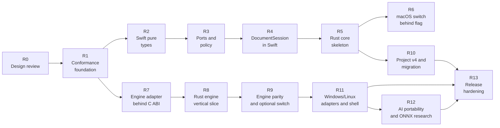

# StudioCore — Extraction Roadmap

**Status:** Proposed roadmap, not approved for implementation
**Milestone:** 4 — StudioCore Architecture & Extraction Design
**Baseline:** `main` / `7cfc8594f416c987386e0abe103cc75121de073a`
**Date:** 2026-11-11
**Companions:** [STUDIOCORE_ARCHITECTURE.md](STUDIOCORE_ARCHITECTURE.md), [STUDIOCORE_INTERFACE_DESIGN.md](STUDIOCORE_INTERFACE_DESIGN.md), [CROSS_PLATFORM_TECHNOLOGY_DECISIONS.md](CROSS_PLATFORM_TECHNOLOGY_DECISIONS.md)

---

## 1. Principles

1. **The macOS app remains shippable at every step.** No step removes a working feature.
2. **Behavior first, language second.** Extract boundaries in Swift before rewriting anything in Rust.
3. **The corpus is the oracle.** A renderer change is not accepted because it looks right; it must pass the measured gates.
4. **No big-bang extraction.** `EditorModel` is split in small, reversible pieces. It is never moved wholesale.
5. **No Rust engine migration before the interface and corpus validation exist.** The audit already orders phases this way (`Docs/PHASE0_CROSSPLATFORM_AUDIT.md:401-408`).
6. **One document truth.** No shell gets a private copy of editing rules.
7. **Format changes are explicit.** v3 is never silently rewritten; v4 is introduced with migration fixtures and a compatibility bridge.
8. **Every step has a rollback path and a behavior-change flag.**
9. **Owner approval at named checkpoints.** Passing tests is necessary but not sufficient for a product-visible switch.
10. **No unrelated cleanup.** A step changes only what its acceptance criteria require.

---

## 2. Starting point

**VERIFIED.**

| Asset | State |
|---|---|
| macOS app | Builds with `./build.sh`; universal / per-arch; self-test gate (`build.sh:162-188`) |
| Unit/regression suites | Four suites via `./Tests/run.sh`; the audit records 840 checks / 0 failures (`Docs/PHASE0_CROSSPLATFORM_AUDIT.md:386`) |
| Golden corpus | 78 cases, 11 categories, 21 reference PNGs, 11 exports, exact same-host digests (`Docs/GOLDEN_IMAGE_CORPUS.md:27-52`) |
| Corpus harness | `./Tests/run-corpus.sh`; opt-in; arm64 and Rosetta (`Tests/run-corpus.sh:1-13`) |
| Image characterization | Pipeline order, masks, operation matrix, export behavior (`Docs/IMAGE_ENGINE_CHARACTERIZATION.md`) |
| Comparison methodology | Canonical pixels, metrics, gates, invalidation (`Docs/IMAGE_COMPARISON_METHODOLOGY.md`) |
| Design package | This milestone's four documents |

**Gaps that affect sequencing:**

- The corpus does not cover Vision detection, AI, RAW/HEIC, or UI (`Docs/IMAGE_ENGINE_CHARACTERIZATION.md:265`).
- The recovery store has no `fsync` (D15; `Docs/PHASE0_CROSSPLATFORM_AUDIT.md:249`).
- The AI installer is disabled (`Sources/RetouchStudio/Core/AIRuntime.swift:40`).
- Qt and ONNX are unproven for this product.

---

## 3. Roadmap at a glance



Two tracks are intentionally parallel after R1:

- **Track A (core):** R2 → R3 → R4 → R5 → R6 → R10.
- **Track B (engine):** R7 → R8 → R9.

R11 needs both: the shared core and a renderer that works off macOS. R12 is optional and does not block the shells unless AI is a launch requirement for those platforms.

**Indicative effort.** The ranges below are person-weeks, ±40%, for a team familiar with the code. They refine audit phases 3–12; they are not additive with the audit's total because work overlaps and some audit phases cover more than one step. They are estimates, not commitments.

---

## 4. Steps

### R0 — Design review and approval

**Goal.** Approve or revise the architecture, interfaces, technology decisions, and this roadmap.

**Scope.** This package: `STUDIOCORE_ARCHITECTURE.md`, `STUDIOCORE_INTERFACE_DESIGN.md`, `CROSS_PLATFORM_TECHNOLOGY_DECISIONS.md`, `STUDIOCORE_EXTRACTION_ROADMAP.md`.

**Dependencies.** None.

**Acceptance.**

- Owner confirms the boundary and the non-goals.
- Open questions in the interface design are assigned an owner.
- The v4 strategy and the compatibility bridge are accepted or revised.
- The first implementation milestone is chosen.

**Tests.** None; documentation review only.

**Risks.** A design that is too abstract to implement; a boundary that silently assumes Core Image is portable. Mitigation: every interface is tied to a source anchor or marked PROPOSED.

**Rollback.** Revise the documents. No code exists.

**Behavior change.** None.

**Checkpoint C0.** Explicit approval to start R1.

---

### R1 — Conformance foundation

**Goal.** Make the contracts testable before any production extraction.

**Scope (future implementation).**

- Document fixtures: minimal, all operations, v3 samples, unknown fields, missing assets.
- Canonical JSON test helpers.
- ABI header draft and a C smoke test.
- Engine render-plan fixtures.
- A conformance runner that does not link AppKit/SwiftUI for core fixtures.
- CI jobs for arm64, x86_64, and a non-Apple build of the core (once the core exists; the CI definition can be prepared here).

**Files/types (expected).** New test-only fixtures and scripts; no production Swift changes. The existing `Tests/run.sh`, `Tests/run-corpus.sh`, `build.sh` remain untouched until a step explicitly changes them.

**Dependencies.** R0.

**Acceptance.**

- Fixtures cover the cases in interface design §11.1–§11.4.
- The C smoke test compiles and runs on the host.
- The corpus harness still passes unchanged.
- No production behavior changes.

**Tests.**

- `./Tests/run.sh`
- `./Tests/run-corpus.sh`
- A new fixture runner (name to be chosen in implementation).
- `git diff --check`

**Risks.** Fixtures that encode today's bugs as contracts. Mitigation: label each fixture as "current behavior" or "target contract"; do not silently bless a defect.

**Rollback.** Delete the fixtures and CI job. No production impact.

**Behavior change.** None.

**Checkpoint C1.** Fixtures reviewed; the owner agrees what is frozen.

---

### R2 — Swift pure types (no behavior change)

**Goal.** Create a Swift `StudioCore` target/module containing value types that do not need UI or Apple rendering.

**Scope.**

- `Adjustments` (`Sources/RetouchStudio/Models/Adjustments.swift:14`).
- Makeup color and shade values (`Sources/RetouchStudio/Models/Makeup.swift`).
- `DocumentOrientation` (`Sources/RetouchStudio/Models/Orientation.swift:13`).
- `HealSpot` and `HealGeometry` (`Sources/RetouchStudio/Models/Heal.swift:10`, `:15`).
- `CropAspect` and `CropGeometry` (`Sources/RetouchStudio/Models/Crop.swift:31`).
- `Sticker` and `ArtGeometry` (`Sources/RetouchStudio/Models/Sticker.swift:19`, `:32`).
- `AnalysisSettings` (`Sources/RetouchStudio/Models/Analysis.swift:68`).
- `UserPreset` (`Sources/RetouchStudio/Models/UserPreset.swift:4`).
- The v3 `RetouchProject` codec (`Sources/RetouchStudio/Models/Project.swift:8`) — data only, not file access.
- `ExportFormat` and `ExportSnapshot` (the data half; `Sources/RetouchStudio/Core/ExportService.swift:10`) if they can move without `CIImage`.
- `BatchExportPolicy` (`Sources/RetouchStudio/Core/BatchExportPolicy.swift:11`).

**Do not move:** `EditorModel`, `AnalysisRenderer`, `ArtRenderer`, `WatermarkRenderer`, `ImageProcessor`, `AISelectOverlay`, or any view.

**Dependencies.** R1.

**Acceptance.**

- The module compiles without AppKit/SwiftUI/CoreImage/ImageIO. `CoreGraphics` is allowed only if a temporary bridge type is unavoidable; the target is to replace `CGPoint`/`CGRect` with plain types.
- Existing tests pass unchanged.
- A project encoded from the same values is byte-identical to the current encoder output for v3 fixtures.
- No public behavior changes.

**Tests.**

- `./Tests/run.sh` on arm64 and `RETOUCH_ARCH=x86_64 ./Tests/run.sh`.
- Project JSON equality fixtures.
- A module-build check that rejects forbidden imports.

**Risks.**

- Swift access control and `@MainActor` helpers pull UI back in. Mitigation: move only pure declarations; leave view helpers in the app.
- `MakeupColor`/`MakeupShade` has SwiftUI helpers. Mitigation: split the plain color from the SwiftUI extension.
- Type identity changes can break call sites. Mitigation: keep the same fully qualified names or add explicit typealiases during the move.

**Rollback.** Move the files back; the app is one compilation unit, so the revert is mechanical.

**Behavior change.** None.

**Checkpoint C2.** Module builds without UI frameworks; tests green.

---

### R3 — Ports and pure policy extraction

**Goal.** Separate portable policy from platform file and OS behavior.

**Scope.**

- Export planning: naming, source-protection policy, metadata allowlist, output plan. Extract the decision from `ExportService` while leaving ImageIO rendering/writing in the adapter.
- `BatchExportPolicy` as a pure planner (already close; add explicit coordinate-space inputs).
- Recovery policy: candidate states, ordering, source identity comparison, epoch invalidation. Separate from `RecoveryStore` file I/O (`Sources/RetouchStudio/Models/Recovery.swift:181-342`).
- Preset service: data and validation, with a file-store port.
- Ports: `SourceAccess`, `FileStore`, `Clock`.
- Fake implementations for tests.

**Dependencies.** R2.

**Acceptance.**

- The macOS app uses the extracted policies through the ports.
- Existing export, batch, recovery, and preset tests pass.
- A fake `FileStore` can exercise candidate ordering, quarantine, and durability failure.
- Source protection still refuses the source file exactly as today.
- Metadata stripping behavior is unchanged.

**Tests.**

- Existing suites plus new fake-port tests.
- A source-protection test that covers resolved paths, device/inode, and case-insensitive fallback on macOS.
- Recovery crash-injection tests against the fake store; real-store tests remain.

**Risks.**

- File identity semantics are subtle (`Sources/RetouchStudio/Core/ExportService.swift:404`). Mitigation: keep the current implementation as the reference and test both.
- Recovery `fsync` absence must not be "fixed" silently in this step. Mitigation: report durability as `bestEffort` until a dedicated durability step.
- Ports that are too wide become a second framework. Mitigation: keep them small and driven by tests.

**Rollback.** Revert to direct calls to the existing stores. The policies are still in Swift, so no format or behavior change.

**Behavior change.** None.

**Checkpoint C3.** Ports and policies green on both architectures.

---

### R4 — `DocumentSession` extraction in Swift

**Goal.** Move document truth and orchestration out of `EditorModel` while it remains the UI adapter.

**This is the highest-risk Swift step. It is split into four sub-steps.**

#### R4a — State and history

- Move `EditState`, undo/redo stacks, clean state, and commit/coalesce boundaries (`Sources/RetouchStudio/Models/EditorModel.swift:313-366`) into `DocumentSession`.
- `EditorModel` keeps published mirrors and calls `session.begin/commit/undo/redo`.
- The 350 ms timer stays in the shell.

**Acceptance.** Undo counts, coalescing, dirty state, and redo clearing are identical in the model tests and a scripted interaction test. No pixel changes.

#### R4b — Load, open, project lifecycle

- Move document installation and project restoration (`Sources/RetouchStudio/Models/EditorModel.swift:963`, `:3195`) into the session.
- Keep `NSOpenPanel`/`NSSavePanel` and alerts in `EditorModel`.
- Keep failed-load preservation and recovery handoff behavior.

**Acceptance.** Open project, open image, relink, recovery restore, and missing-source flows match the existing tests. The previous document survives a failed load.

#### R4c — Export orchestration

- Move `makeExportSnapshot`, export validation, and plan creation (`Sources/RetouchStudio/Models/EditorModel.swift:3028`) into the session.
- Keep the sheet and panel in the shell.
- The engine call remains where it is until R7.

**Acceptance.** Export output pixels, metadata, naming, source protection, cancellation, and error text are unchanged.

#### R4d — Batch orchestration

- Move batch job creation and per-file policy (`Sources/RetouchStudio/Models/EditorModel.swift:3329`, `:3426`) into the session/planner.
- Keep the batch sheet and folder selection in the shell.
- Preserve cancellation propagation and unique names.

**Acceptance.** The batch regression suite passes; rotated/aspect cases behave as today; cancellation stops between files and mid-write as designed.

**Dependencies.** R3.

**Risks.**

- `EditorModel` has 92 published properties and many call sites; a mechanical move can hide a behavior change. Mitigation: one sub-step at a time, with a forwarding shim and a scripted UI regression.
- Async ordering and operation tokens are subtle (`Sources/RetouchStudio/Models/EditorModel.swift:234-306`). Mitigation: add a state-machine test before moving.
- Recovery interaction is timing-sensitive. Mitigation: keep the existing barrier and epoch tests.

**Rollback.** Each sub-step is independently revertible. The session can call back into the old methods during the transition.

**Behavior change.** None intended. Any visible difference is a defect.

**Checkpoint C4.** All four sub-steps green on arm64 and Rosetta; owner reviews a scripted editing session.

---

### R5 — Rust StudioCore skeleton and dual-run conformance

**Goal.** Implement the portable core in Rust and prove it agrees with the Swift reference.

**Scope.**

- Rust crate with `domain`, `document`, `operations`, `history`, `project`, `presets`, `export`, `batch`, `recovery`, `validation`.
- C ABI header and FFI module.
- Canonical JSON codec.
- v3 reader and v4 codec (writer can come in R10).
- Conformance runner that feeds the same fixtures to Swift and Rust and compares canonical output.

**Do not:** connect it to the app yet; implement the image engine; implement AI; add UI dependencies.

**Dependencies.** R2, R3, R4 (the Swift session is the behavioral reference), R1.

**Acceptance.**

- Rust builds on macOS, Windows, and Linux without Apple SDKs.
- All document fixtures produce identical canonical JSON and revisions.
- History fixtures produce identical undo/redo results.
- Project fixtures round-trip with unknown fields preserved.
- A C program compiles against the header and exercises create/call/destroy.
- No panic crosses FFI.
- Performance of document commands is acceptable for interactive use (measure; no fixed threshold yet).

**Tests.**

- `cargo test`, property tests, fuzz on the decoder.
- Cross-language fixture runner.
- C ABI smoke test.
- Non-Apple build job.

**Risks.**

- Dual-model drift. Mitigation: JSON fixtures are the contract; both implementations are tested against them, not against each other's source.
- FFI ownership bugs. Mitigation: small ABI, release functions, leak tests.
- JSON numeric differences. Mitigation: canonical number rules and round-trip tests.
- The Rust core may be slower to iterate. Mitigation: keep the Swift path until conformance is green.

**Rollback.** The Rust crate is not linked into the product. Delete or ignore it; the Swift app is unaffected.

**Behavior change.** None (not shipped).

**Checkpoint C5.** Conformance green; owner approves an internal switch.

---

### R6 — Switch the macOS document session to Rust behind a flag

**Goal.** Use the Rust core for document state, history, project parsing, and policy on macOS, with a one-release fallback.

**Scope.**

- A feature flag selects Swift `DocumentSession` or Rust session.
- The Swift shell calls the C ABI through a thin adapter.
- The editor's published state is fed from either implementation.
- Logging records which path ran.

**Dependencies.** R5.

**Acceptance.**

- With the flag on, the full suite and corpus pass.
- Project files written by both paths are canonical-identical for the same state.
- Undo/redo, recovery, export planning, and batch planning match.
- A kill-switch returns to Swift without data loss.
- No visible UI change.

**Tests.**

- The full suite twice, once per flag value.
- A migration test that opens a v3 project, edits it, saves, and reopens.
- Crash tests for recovery.

**Risks.**

- A Rust bug becomes a macOS bug. Mitigation: flag, dual-run in staging, and a fast rollback.
- Performance regression. Mitigation: measure command latency and memory.
- FFI lifetime bug. Mitigation: leak tests and a single owner per session.

**Rollback.** Flip the flag off; keep the Swift path for at least one release.

**Behavior change.** Internal only; no visible change is allowed.

**Checkpoint C6.** Owner approves default-on after a release cycle with no parity defect.

---

### R7 — Wrap the current engine behind the C ABI

**Goal.** Put the existing Core Image pipeline behind the image-engine contract without changing pixels.

**Scope.**

- `CoreImageEngineAdapter` implements `sc_engine_*`.
- A render plan is produced by StudioCore and decoded by the adapter.
- Masks, faces, assets, cancellation, and progress are passed explicitly.
- The macOS shell calls the adapter; the old direct `ImageProcessor` path remains behind a flag.

**Dependencies.** R1 (corpus), R4 (session), R5 (plan production). Can start after R1 in parallel with R3/R4 for the adapter shell.

**Acceptance.**

- All 78 corpus cases produce the same canonical pixels and digests on the same host.
- The 21 reference PNGs and 11 exports still compare as before.
- Export metadata policy, alpha flattening, 16-bit output, and long-edge scaling are unchanged.
- Cancellation and progress map correctly.
- No filter parameter changes.

**Tests.**

- `./Tests/run-corpus.sh` on arm64 and Rosetta.
- `./Tests/run.sh`.
- `./build.sh` and `--selftest`.
- A buffer-ownership test (create, render, release, leak check).

**Risks.**

- Copying pixels at the boundary adds latency. Mitigation: pass buffers by reference; measure preview latency.
- The adapter's coordinate conversion can shift masks by a pixel. Mitigation: corpus exact gate.
- `CIContext` thread behavior. Mitigation: declare concurrency and test parallel preview/export.

**Rollback.** The shell calls `ImageProcessor` directly; the adapter is unused.

**Behavior change.** None.

**Checkpoint C7.** Corpus exact; owner accepts the adapter as the macOS engine path.

---

### R8 — Rust engine vertical slice (not shipped)

**Goal.** Prove that a portable engine can reproduce a meaningful subset before committing to it.

**Scope.**

- CPU-first Rust engine for deterministic stages: orientation, crop, global color/light, and one local stage (skin or heal).
- `wgpu` prototype only if the CPU slice is insufficient; do not build two engines.
- A comparison harness that runs the same operations through the Core Image adapter and the Rust engine.

**Dependencies.** R7, R1.

**Acceptance.**

- Per-stage pixel comparison on the corpus subset.
- Deterministic stages meet the same-host exact gate where feasible; otherwise a measured tolerance is documented and approved.
- Performance is measured on the M3/16 GB target; no product threshold is assumed.
- No product path uses the Rust engine.

**Tests.**

- Corpus subset, both implementations.
- Fuzz on operation parameters.
- Memory and cancellation tests.

**Risks.**

- Color-space differences dominate the result. Mitigation: isolate color conversion from the retouch math.
- Mask rasterization differs. Mitigation: compare masks before comparing composited pixels.
- GPU/CPU divergence. Mitigation: keep a CPU tier as the reference and declare GPU tolerance.

**Rollback.** Delete the prototype; the macOS adapter remains the engine.

**Behavior change.** None (not shipped).

**Checkpoint C8.** Owner decides whether the slice justifies full parity work.

---

### R9 — Engine parity and optional switch

**Goal.** Complete the portable engine path and allow it to be selected per stage or per platform behind gates.

**Scope.**

- Remaining stages: masks, under-eye, teeth, eyes, makeup, hair, reshape, body, pose, background, art, analysis overlay, final crop.
- AI compositing and asset handling.
- Face/person detection adapter or a portable detector decision.
- Performance and memory work.

**Dependencies.** R8.

**Acceptance.**

- Full corpus parity per the methodology.
- Export output and metadata parity.
- Cancellation at every stage.
- A per-stage feature flag; macOS defaults to Core Image until the owner approves otherwise.
- Windows/Linux can render the required feature set.

**Tests.**

- Full corpus on macOS, with the Rust engine and the adapter.
- Cross-platform corpus runs on Windows/Linux hardware, with tolerances recorded.
- Export characterization.
- Long-running memory tests.

**Risks.** This is the largest technical risk. Mitigation: stage-by-stage gates, no all-at-once switch, and the macOS adapter as a permanent fallback.

**Rollback.** Per-stage flags return to the adapter. The core and project work remain.

**Behavior change.** Visible only if a stage is switched; each switch needs explicit approval.

**Checkpoint C9.** Owner approves the first shipping stage and the platform matrix.

---

### R10 — Project v4 writer, migration, and compatibility projection

**Goal.** Introduce the v4 package while keeping v3 projects safe.

**Scope.**

- v4 writer with the staged save protocol and durability contract.
- v3 reader and migration fixtures.
- v4 → v3 projection for representable documents.
- Unknown-field preservation.
- Source relocation and relink flow.
- Recovery candidate format aligned with v4.
- UI messaging for unsupported capabilities and lossy compatibility copies.

**Dependencies.** R5 (codec), R6 (macOS session), R4 (project lifecycle). Can start after R5; migration fixtures can start in R1.

**Acceptance.**

- Every v3 fixture opens, edits, saves, and reopens.
- Unknown optional fields survive a v4 round-trip.
- A required unknown capability refuses read-write.
- A missing or changed source produces the right state and relink flow.
- Crash injection at every save step recovers to a valid generation.
- A 1.0-era build can open a v3 projection when the document is representable.
- The new app never silently overwrites the only v3 copy with v4.

**Tests.**

- Migration fixture suite.
- Crash-injection tests on APFS, NTFS, and a Linux filesystem.
- Source relocation tests.
- Compatibility projection tests with a 1.0 binary or a frozen v3 reader.

**Risks.**

- Directory swap semantics differ by OS. Mitigation: per-OS adapter and crash tests.
- Asset paths in v3 AI edits may be unreachable. Mitigation: explicit missing-asset state and relink.
- Users may be confused by a package. Mitigation: present it as one document; avoid exposing internals.
- Backup tools may not handle packages. Mitigation: document behavior; test Time Machine/OneDrive.

**Rollback.** Keep v3 as the writer; v4 writer behind a flag per document. Never delete v3 files.

**Behavior change.** Visible format change on explicit save/upgrade; v3 open remains unchanged.

**Checkpoint C10.** Owner approves the default v4 writer after migration and crash gates pass.

---

### R11 — Windows and Linux platform adapters and shell

**Goal.** Ship a native shell on a second platform using the shared core and engine.

**Scope.**

- Windows adapter: dialogs, paths, file identity, atomic replace, decode/encode, color, GPU, IPC, process identity, notifications.
- Linux adapter: same set with the supported desktop/filesystem matrix.
- Qt 6/QML shell for the editor surface, or a separately approved UI technology.
- Packaging, signing, and update path.

**Dependencies.** R6 (core), R9 (engine coverage for the shipped feature set), R10 (project format), R12 transport only if AI is in the first release.

**Acceptance.**

- Open, edit, export, batch, presets, and recovery work on real hardware.
- Persian shaping, bidi, IME, menus, shortcuts, and accessibility pass the prototype requirements.
- Color-managed canvas matches the approved reference within the documented tolerance.
- Source protection refuses the source file on the platform.
- Crash recovery works with the platform file store.
- The macOS app is unchanged.

**Tests.**

- Native interaction tests on real hardware.
- Corpus runs on the target platform.
- Crash injection, long paths, Unicode paths, permissions.
- Packaging/install/uninstall tests.

**Risks.**

- Qt color/input/accessibility gaps. Mitigation: prototype before committing to the shell.
- Windows file semantics. Mitigation: adapter-specific tests.
- Third-platform maintenance cost. Mitigation: one core, one UI per platform, shared conformance.

**Rollback.** Do not ship the shell; the macOS app and the core remain. A platform can be deferred independently.

**Behavior change.** New platform only; macOS unchanged.

**Checkpoint C11.** Owner approves the platform support matrix and release criteria.

---

### R12 — AI portability and ONNX research

**Goal.** Make the AI boundary portable and evaluate a common inference runtime without risking the current path.

**Scope.**

- Transport port for Windows/Linux; same JSON-RPC framing.
- Runtime status and provenance in the portable job schema.
- Fake worker tests on each platform.
- ONNX research for one task (segmentation or upscaling), behind the `AiEngine` contract.
- No model change without a quality diff.

**Dependencies.** R11 for the second platform; R5 for the job schema; R9 for any AI composition changes.

**Acceptance.**

- The fake worker passes on all supported platforms.
- AI unavailability leaves the editor fully usable.
- Provenance is recorded for every edit.
- ONNX, if tested, matches or is explicitly compared against the current quality; licensing is cleared.
- The Python path remains available.

**Tests.**

- Protocol conformance, crash, cancel, timeout, duplicate submission.
- One-task quality comparison if ONNX is tried.
- Memory measurement on 16 GB hardware.

**Risks.**

- Model conversion/licensing. Mitigation: research gate, no shipping until cleared.
- Execution-provider differences. Mitigation: per-provider comparison and declared fallback.
- Runtime size. Mitigation: optional component and explicit download.

**Rollback.** Keep Python; discard the ONNX prototype.

**Behavior change.** AI only, and explicit.

**Checkpoint C12.** Owner decides whether AI ships on the new platform and whether ONNX is worth a second phase.

---

### R13 — Release hardening

**Goal.** Make the cross-platform product releasable without weakening the macOS product.

**Scope.**

- Signing/notarization per platform.
- Installer/uninstaller, crash reporting policy, privacy documentation.
- Localization parity, accessibility audit, RTL screenshots.
- Recovery and format documentation.
- Release checklist and rollback plan.

**Dependencies.** R11, R12 (if applicable), R10, R6.

**Acceptance.**

- Release checklist complete.
- All suites and corpus gates green on supported platforms.
- A documented rollback to the previous release.
- No unsupported claim in the docs.

**Tests.**

- Full matrix.
- Install/upgrade/downgrade with existing projects.
- AI optional on/off.

**Risks.** Signing identities, store policies, hardware availability.

**Rollback.** Keep the previous release artifacts and format compatibility.

**Behavior change.** Release-level.

**Checkpoint C13.** Owner signs the release.

---

## 5. Step dependency and rollback summary

| Step | Depends on | Reversible by | Behavior flag | Owner checkpoint |
|---|---|---|---|---|
| R0 | — | Revise docs | None | C0 |
| R1 | R0 | Delete fixtures/CI job | None | C1 |
| R2 | R1 | Move files back | None | C2 |
| R3 | R2 | Revert to direct calls | None | C3 |
| R4 | R3 | Sub-step revert; forwarding shim | None | C4 |
| R5 | R1, R2, R4 | Do not link the crate | None (not shipped) | C5 |
| R6 | R5 | Flip flag to Swift | Internal | C6 |
| R7 | R1, R4, R5 | Call `ImageProcessor` directly | Internal | C7 |
| R8 | R1, R7 | Delete prototype | None (not shipped) | C8 |
| R9 | R8 | Per-stage flag to adapter | Visible per stage | C9 |
| R10 | R4, R5, R6 | Keep v3 writer | Format | C10 |
| R11 | R6, R9, R10 | Do not ship the shell | New platform | C11 |
| R12 | R11, R5, R9 | Keep Python | AI | C12 |
| R13 | R11, R12, R10, R6 | Previous release | Release | C13 |

---

## 6. Behavior-change classification

| Class | Meaning | Examples |
|---|---|---|
| **None** | Output, files, and interactions must be identical. | R2, R3, R4, R7 |
| **Internal** | No visible change; a flag can revert. | R6, R7 |
| **Format** | Project bytes or extension change; migration required. | R10 |
| **Visible** | Pixels or UI behavior change; owner approval required. | A stage switched in R9 |
| **Platform** | New OS support; macOS unchanged. | R11 |
| **AI** | Model/runtime change; quality diff required. | R12 |

A step must declare its class before it starts. A step that discovers a visible change must stop and request approval rather than treating it as an implementation detail.

---

## 7. Validation at every checkpoint

The following commands are the current baseline. Future steps add commands; they do not replace these until the replacement has equivalent coverage.

```bash
# Regression suites (arm64 host)
./Tests/run.sh

# Regression suites, Intel slice under Rosetta
RETOUCH_ARCH=x86_64 ./Tests/run.sh

# Golden corpus on the host
./Tests/run-corpus.sh

# Golden corpus on the Intel slice
RETOUCH_ARCH=x86_64 ./Tests/run-corpus.sh

# App build, universal, with self-test gates
./build.sh

# Whitespace and patch hygiene
git diff --check
```

Additional gates by step:

- R5: `cargo test`, cross-target builds, C ABI smoke test, fuzz.
- R6: the full suite with the Rust flag on and off.
- R7: corpus exact; export characterization; leak test.
- R8/R9: per-stage corpus comparison; performance and memory measurements; Windows/Linux hardware runs.
- R10: migration fixtures, crash injection, v3 projection with a frozen 1.0 reader.
- R11: native interaction, color, RTL, IME, accessibility, packaging.
- R12: fake worker, protocol, one-task quality comparison (if ONNX is tried).

A checkpoint is not passed because a command exited zero. The evidence must be attached to the checkpoint: command, architecture, commit, result, and any known gaps.

---

## 8. Risk register

### 8.1 Verified facts that constrain the plan

| Fact | Evidence | Consequence |
|---|---|---|
| The app is one flat Swift module | `build.sh:58`; `Tests/run.sh:35` | Extraction must introduce real targets before portability claims |
| `EditorModel` is the UI controller | `Sources/RetouchStudio/Models/EditorModel.swift:9`, `:16-196`, `:841` | Do not extract it wholesale |
| Core and Models are cyclically dependent | `Core/ExportService.swift` uses Models; `EditorModel` uses Core | Split value types first, then ports |
| v3 stores an absolute path and bookmark | `Sources/RetouchStudio/Models/Project.swift:21-24` | v4 migration is mandatory for portability |
| The AI installer is disabled | `Sources/RetouchStudio/Core/AIRuntime.swift:40` | AI is optional; do not block the editor |
| Recovery has no `fsync` | D15 in `Docs/PHASE0_CROSSPLATFORM_AUDIT.md:249` | Do not claim crash safety before durability work |
| Corpus excludes Vision/AI/RAW/HEIC/UI | `Docs/IMAGE_ENGINE_CHARACTERIZATION.md:265` | Engine parity claims must state the gap |
| Cross-platform tolerance gates are provisional | `Docs/IMAGE_COMPARISON_METHODOLOGY.md:127` | Do not publish a tolerance as measured fact |

### 8.2 Risk matrix

| Risk | Probability | Impact | Mitigation | Evidence needed |
|---|---|---|---|---|
| Extraction changes editing behavior | Medium | High | One sub-step at a time; forwarding shim; scripted UI regression | Before/after interaction traces |
| Rust/Swift schema drift | Medium | High | Canonical fixtures; one source of truth; dual-run CI | Fixture equality |
| Project migration loses data | Medium | High | Read-only on unknown required capability; preserve unknown fields; never delete v3; crash tests | Migration corpus |
| Directory save is not durable | Medium | High | Journal, fsync contract, crash injection per OS | Crash tests |
| Rust engine cannot match pixels | High (unproven) | High | Adapter first; per-stage gates; macOS fallback | Corpus and tolerance report |
| Color management differs | High | High | Explicit profiles; isolate conversion; compare P3/sRGB | Measured ΔE and pixel diffs |
| Vision detection differs | Medium | Medium | Store snapshots; version detectors; declare platform dependence | Detection corpus |
| AI runtime unavailable on new platforms | High | Medium | Optional capability; transport port; no hard dependency | Platform runtime tests |
| ONNX quality/licensing fails | Medium | Medium | Research gate; keep Python | One-task comparison |
| Qt cannot meet color/input/RTL needs | Medium | High | Prototype before commitment; keep macOS shell | Real-image prototype |
| FFI ownership bug | Medium | High | Small ABI; release functions; leak tests; panic containment | ASAN/leak runs |
| Performance regression | Medium | Medium | Measure per stage; CPU tier; cache budget | Benchmarks on target hardware |
| Memory pressure on 16 GB | Medium | Medium | Bounded caches; stream assets; measure snapshots | Memory profiles |
| Windows path/permission surprises | High | Medium | Adapter-specific tests; real hardware | Windows test report |
| Packaging/signing delays | Medium | Medium | Early signing plan; per-OS artifacts | Installer tests |
| Maintenance cost of two implementations | Medium | Medium | Time-box the dual-run; switch and delete the fallback only after approval | Release history |

### 8.3 Hypotheses that must not be treated as facts

- Rust engine parity and performance.
- ONNX Runtime quality, licensing, and memory.
- Qt color/IME/tablet/accessibility parity.
- Directory-package acceptance by users and backup tools.
- Windows directory-swap durability.
- Full snapshot history memory on large documents.
- Static linking of the core into both shells.

Each has an explicit validation step above.

---

## 9. What not to do

- Do not extract `EditorModel` in one move.
- Do not start the Rust engine before the interface and corpus validation exist.
- Do not switch a render stage without a measured comparison and owner approval.
- Do not rewrite v3 projects in place.
- Do not delete the v3 reader or the macOS Core Image path during the transition.
- Do not add a general operation graph because it sounds more flexible; the pipeline order is a quality invariant.
- Do not choose Qt, ONNX, or a portable detector without the prototype or comparison named above.
- Do not treat the 78-case corpus as complete coverage.
- Do not claim crash safety while the store lacks a durability guarantee.
- Do not commit, push, or release any of this without explicit approval.

---

## 10. First implementation milestone after design review

**RECOMMENDATION.** Start with **R1 + R2**, not with Rust and not with the engine:

1. **R1** freezes the conformance fixtures and the ABI header draft. It is low-risk and prevents later rework.
2. **R2** moves pure value types into a Swift module that builds without UI frameworks. It is reversible, has no behavior change, and proves the boundary is real before any language switch.

Only after C2 is green should the team start R3/R4. Only after C5 (Rust conformance) should the macOS app switch. Only after C7 (adapter corpus) should anyone consider the engine port.

This order follows the audit's sequencing rules (`Docs/PHASE0_CROSSPLATFORM_AUDIT.md:401-408`) and the project's quality-first constraint.
