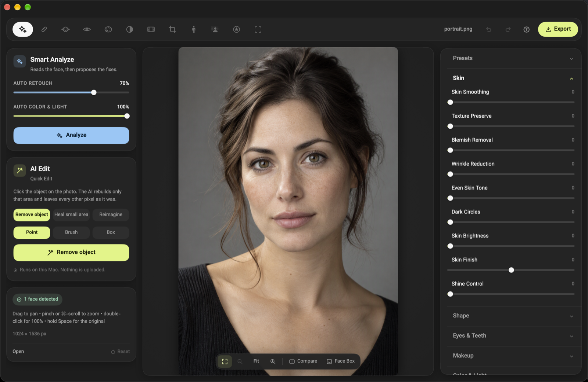
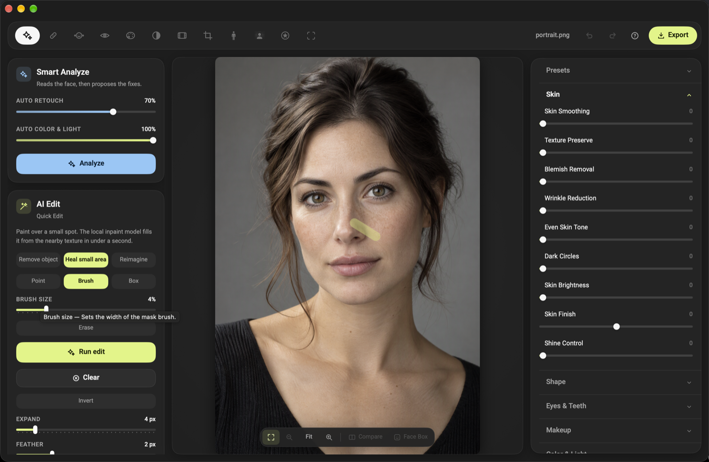
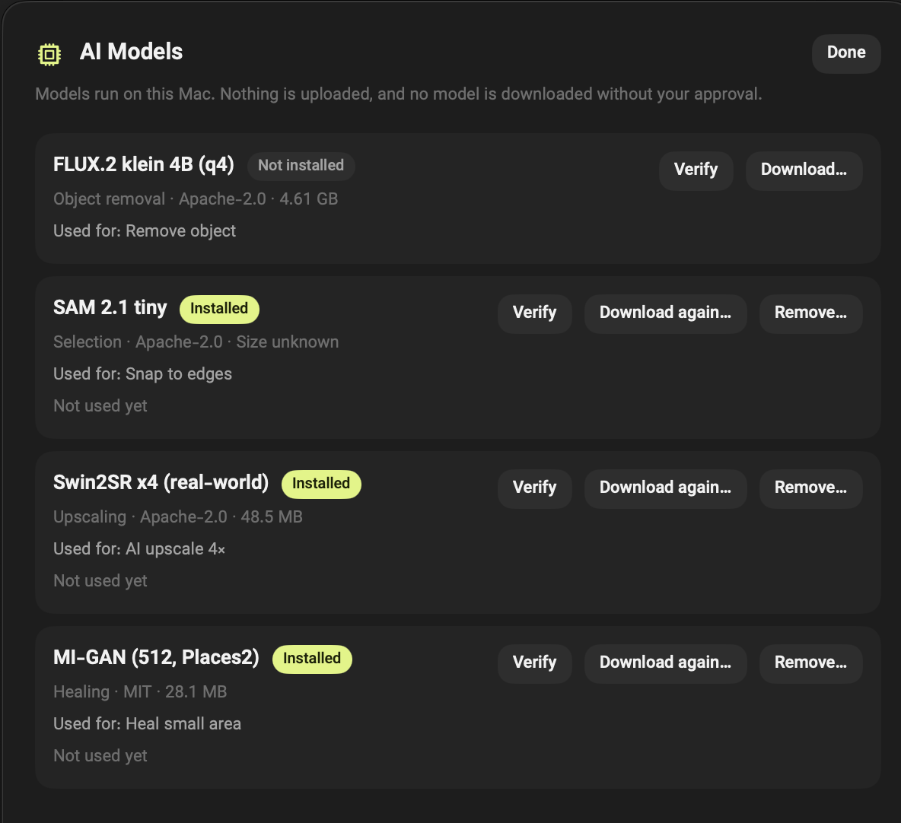

# Retouch Studio

[English](README.md) · **فارسی**

یک استودیوی بومیِ رتوش پرتره برای مک، با رابط دوزبانهٔ انگلیسی و فارسی. همه‌چیز — تحلیل، رتوش، ماسک‌گذاری، بزرگ‌نمایی و خروجی — روی همین دستگاه اجرا می‌شود. هیچ سرویس ابری، حساب کاربری یا آپلود خودکاری وجود ندارد.

ساخته‌شده با SwiftUI، Core Image و Vision و منتشرشده به‌صورت یک `.app` خودکفا که به Xcode، Homebrew یا نصب جداگانهٔ پایتون نیاز ندارد.

## ویژگی‌ها

- **دوازده ابزار در یک بازرس**: پوست، درمان، اصلاح فرم، چشم و دندان، آرایش، رنگ و نور، ظاهرها، برش، بدن، پس‌زمینه، برچسب‌ها و تحلیل.
- **ویرایش غیرمخرب**: هر تنظیم فقط یک مقدار در پروژه است، بنابراین فایل ذخیره‌شدهٔ `.retouch` بعداً هم باز و تغییرپذیر می‌ماند. تا ۱۰۰ مرحله برگشت و ازنو.
- **تحلیل خودکار** همراه با نمایش شبکهٔ چهره: پوست، چشم‌ها، دندان‌ها و پس‌زمینه اندازه‌گیری می‌شوند و رتوش خودکار فقط همان چیزی را تغییر می‌دهد که اندازه‌گیری توجیه می‌کند.
- **دستیار اختیاری هوش مصنوعی محلی**: حذف یک شیء از ناحیهٔ علامت‌خورده، ادامهٔ بافت روی ناحیه‌ای کوچک، بازآفرینی کادر از روی یک توضیح، یا بزرگ‌نمایی ۴×. مدل‌ها فقط با درخواست شما دانلود می‌شوند؛ هیچ چیزی آپلود نمی‌شود.
- **فایل پروژه و بازیابی**: پروژه‌های `.retouch`، پیش‌تنظیم‌های قابل ویرایش و یک نسخهٔ بازیابیِ خودکار تا زمانی که کارِ ذخیره‌نشده وجود دارد.
- **کنترل خروجی**: JPEG، PNG، TIFF یا HEIC، محدودیت ضلع بزرگ، لغزندهٔ کیفیت، واترمارک، نمایش اختیاری شبکهٔ چهره، و حذف GPS و مشخصات دوربین از نسخهٔ ذخیره‌شده.
- **رابط دوزبانه**: بومی‌سازی کامل انگلیسی و فارسی (شامل ارقام فارسی)، قابل تغییر در تنظیمات.
- **راهنمای شناور همه‌جا**: هر ابزار، بخش، نماد و لغزنده خودش را در یک راهنمای شناور توضیح می‌دهد.

## تصاویر



*تحلیل هوشمند و ویرایش AI در سمت چپ، بوم مقایسهٔ قبل/بعد و بازرس ابزارها در سمت راست.*


*علامت‌گذاری ناحیهٔ کوچک برای مدل inpainting محلی؛ اندازهٔ قلم‌مو، گسترش و نرمی قابل تنظیم است.*



*هر کنترل هنگام شناور شدن خودش را توضیح می‌دهد — اینجا اندازهٔ قلم‌موی AI.*



*مدیر مدل‌ها حجم، مجوز و وضعیت بررسی هر فایل را نشان می‌دهد؛ دانلود فقط بعد از تأیید شروع می‌شود.*

تصاویر از یک پرترهٔ ساختگیِ تولیدشده با هوش مصنوعی استفاده می‌کنند. هیچ عکس شخصی در این مخزن وجود ندارد.

## پیش‌نیازها

- macOS 14 Sonoma یا جدیدتر روی Apple silicon یا Intel. نسخه‌ها به‌صورت دو دیسک‌ایمیج جدا منتشر می‌شوند — arm64 برای Apple silicon و x86_64 برای Intel — به‌همراه یک آرشیو zip یونیورسال سبک.
- ابزارهای AI به Apple silicon نیاز دارند. دانلود روی هر دو معماری همان اپ سبک است: روی Apple silicon بخش **تنظیمات → مدیریت مدل‌ها** ابتدا runtime دستیار محلی را (حدود ۳۹۰ مگابایت، با بررسی SHA256، از صفحهٔ انتشار همین مخزن) بعد از نمایش فایل و checksum پیشنهاد می‌دهد و بعد هر مدل را جداگانه با تأیید خودش. روی Intel ویرایشگر، تحلیل و خروجی کامل کار می‌کنند و ابزارهای AI اعلام می‌کنند که runtime در دسترس نیست.
- برای اجرای نسخهٔ آماده: هیچ چیز دیگری لازم نیست. اپ خودکفاست.
- برای ساخت از سورس: Xcode Command Line Tools (`xcode-select --install`). خود Xcode لازم نیست؛ `build.sh` مستقیماً با `swiftc` کامپایل می‌کند.

ویندوز و لینوکس پشتیبانی نمی‌شوند: رابط بر SwiftUI/AppKit و موتور پردازش بر Core Image و Vision ساخته شده که هیچ‌کدام بیرون از مک وجود ندارند.

## اجرای نسخهٔ آماده

1. دیسک‌ایمیج مناسب همین مک را دانلود کنید — `RetouchStudio-1.0.0-arm64.dmg` برای Apple silicon یا `RetouchStudio-1.0.0-x86_64.dmg` برای Intel — باز کنید و `Retouch Studio.app` را به پوشهٔ Applications بکشید. حجم اپ حدود ۳٫۵ تا ۴ مگابایت است. runtime اختیاری AI (حدود ۳۹۰ مگابایت) و وزن مدل‌ها بعداً از **تنظیمات → مدیریت مدل‌ها** دانلود می‌شوند، هرکدام بعد از نمایش فایل، حجم و SHA256. یک آرشیو zip یونیورسال سبک هم برای کسانی که آرشیو ساده می‌خواهند در دسترس است.
2. اولین اجرا: روی اپ راست‌کلیک کنید و **Open** را بزنید، یا آن را از **System Settings → Privacy & Security → Open Anyway** مجاز کنید. نسخه‌های منتشرشده امضای ad-hoc دارند و notarize نشده‌اند، بنابراین Gatekeeper یک‌بار سؤال می‌کند. دلیل و ادامهٔ مسیر در [`Docs/RELEASING.md`](Docs/RELEASING.md) آمده است.

## ساخت از سورس

```bash
git clone <repository-url> RetouchStudio
cd RetouchStudio

./build.sh release                       # ساخت یونیورسال، خودآزمون، امضای ad-hoc
open "Retouch Studio.app"
```

ساخت پیش‌فرض یونیورسال است. اگر به بخش معماری دیگر نیازی نیست، ساخت تک‌معماری هم ممکن است:

```bash
RETOUCH_ARCH=arm64 ./build.sh release    # فقط Apple silicon
RETOUCH_ARCH=x86_64 ./build.sh release   # فقط Intel
```

ساخت یونیورسال ابتدا خودآزمون را بومی اجرا می‌کند و بعد دوباره از طریق بخش Intel (زیر Rosetta روی ماشین Apple silicon)، بنابراین یک نسخهٔ منتشرشده نمی‌تواند معماریِ آزمایش‌نشده داشته باشد.

بیلد اپ را در ریشهٔ مخزن در `Retouch Studio.app` می‌سازد و نسخه را از `Resources/Info.plist` برمی‌دارد. نسخهٔ انتشار را می‌توان بدون ویرایش سورس تغییر داد:

```bash
RETOUCH_VERSION=1.0.0 RETOUCH_BUILD=1 ./build.sh release
```

ساخت دیباگ (بدون بهینه‌سازی):

```bash
./build.sh debug
```

صفحهٔ نصب DMG (نام فایل از معماری ساخته‌شده پیروی می‌کند):

```bash
RETOUCH_ARCH=arm64 RETOUCH_SKIP_WORKER=1 ./build.sh release
./Tools/make-dmg.sh                      # RetouchStudio-<version>-arm64.dmg + checksum

RETOUCH_ARCH=x86_64 RETOUCH_SKIP_WORKER=1 ./build.sh release
./Tools/make-dmg.sh                      # RetouchStudio-<version>-x86_64.dmg + checksum
```

آرشیو runtime برای دانلود درخواستی از یک بیلد دارای دستیار ساخته می‌شود، پیش از آنکه اپ دوباره بدون آن بیلد شود:

```bash
RETOUCH_ARCH=arm64 ./build.sh release    # Worker/ داخل اپ باندل می‌شود
./Tools/make-runtime.sh "Retouch Studio.app/Contents/Resources/Worker"
                                         # RetouchStudio-<version>-ai-runtime-arm64.zip + checksum
```

`make-runtime.sh` حجم بایت و SHA256 را چاپ می‌کند تا در `AIRuntime.swift` نگه داشته شود؛ اپ آرشیوی را که هش یا حجمش مطابق نباشد نمی‌پذیرد.

## دستیار محلی هوش مصنوعی اختیاری است

ابزارهای AI (حذف شیء، درمان ناحیه، بازآفرینی و بزرگ‌نمایی ۴×) در یک worker محلی پایتون اجرا می‌شوند. نسخه‌های منتشرشده آن را همراه ندارند: اپ چند مگابایت است و **تنظیمات → مدیریت مدل‌ها** runtime دستیار (حدود ۳۹۰ مگابایت) را بعد از نمایش نام فایل، حجم و SHA256 پیشنهاد می‌دهد. اپ آن آرشیو را از صفحهٔ انتشار همین مخزن دانلود می‌کند، هش را بررسی می‌کند و در `~/Library/Application Support/RetouchStudio/AI/runtime` نصب می‌کند. مدل‌ها جداگانه و هرکدام پس از تأیید فهرست خودشان دانلود می‌شوند.

یک بیلد می‌تواند دستیار را داخل اپ هم داشته باشد؛ در این حالت مفسر قابل‌جابه‌جایی و wheelهای لازم در `Retouch Studio.app/Contents/Resources/Worker` کپی می‌شوند (حدود ۱٫۳ تا ۱٫۶ گیگابایت). وزن مدل‌ها در هیچ حالت باندل نمی‌شود.

بدون دستیار هم ویرایشگر اجرا می‌شود؛ ابزارهای AI راه نصب را نشان می‌دهند. runtime فقط Apple silicon است، بنابراین مک اینتل ویرایشگر را بدون AI اجرا می‌کند.

```bash
./build.sh release                                   # اگر پیدا شود، دستیار باندل می‌شود
RETOUCH_WORKER_ROOT=/path/to/worker \
  RETOUCH_WORKER_VENV=/path/to/venv ./build.sh release   # اشارهٔ صریح به checkout
RETOUCH_SKIP_WORKER=1 ./build.sh release             # فقط اپ، بدون دستیار
```

هنگام اجرا، اپ ابتدا دستیار باندل‌شده را ترجیح می‌دهد، سپس runtime نصب‌شده به‌صورت درخواستی در Application Support را، و بعد checkout سورس را که با بالا رفتن از مسیر اجرایی تا شش سطح و یافتن پوشه‌ای شامل `worker/retouch_ai_worker` پیدا می‌شود؛ `RETOUCH_AI_WORKER_ROOT` و `RETOUCH_AI_PYTHON` آن را بازنویسی می‌کنند. جزئیات، نسخهٔ وابستگی‌ها و مجوز مدل‌ها در [`Docs/AI_RUNTIME.md`](Docs/AI_RUNTIME.md) است.

## تست‌ها

```bash
./Tests/run.sh
```

`Tests/run.sh` کل درخت سورس را با `swiftc` کامپایل می‌کند و دو مجموعه را روی پیکسل‌های واقعیِ رندرشده اجرا می‌کند:

- `EngineTests.swift` — خط لولهٔ تصویر، تحلیل، هندسه، آرایش، ظاهرها، خروجی و رفتار ماسک.
- `ModelTests.swift` — رفت‌وبرگشت پروژه، پیش‌تنظیم‌ها، تنظیمات، کامل بودن بومی‌سازی و بازیابی.

worker مجموعهٔ پایتونی خودش را دارد (`unittest`)؛ در [`Docs/AI_RUNTIME.md`](Docs/AI_RUNTIME.md) توضیح داده شده است.

## حریم خصوصی

- تحلیل تصویر، ویرایش، بزرگ‌نمایی و خروجی کاملاً محلی‌اند؛ هیچ چیزی آپلود نمی‌شود.
- تنها استفادهٔ شبکه در کل محصول دو دانلود صریح است: آرشیو اختیاری runtime و وزن مدل‌ها. هر دو بعد از نمایش فهرست دقیق فایل‌ها، حجم و SHA256 و با درخواست کاربر انجام و پیش از نصب بررسی می‌شوند.
- runtime یک‌بار از صفحهٔ انتشار همین مخزن گرفته می‌شود؛ اپ هیچ نشانی خروجیِ دیگری، تله‌متری یا درخواست پس‌زمینه‌ای ندارد.
- GPS و مشخصات دوربین از نسخه‌های خروجی حذف می‌شوند.
- بدون تله‌متری، بدون تحلیل رفتار و بدون سرویس گزارش خطا.

فهرست اندازه‌گیری‌شده — فریم‌ورک‌ها، سوکت‌ها، رضایت دانلود و روش نمونه‌گیری زمان اجرا — در [`Docs/PRIVACY_AUDIT.md`](Docs/PRIVACY_AUDIT.md) است.

## ساختار پروژه

```
Sources/RetouchStudio/
  App.swift            نقطهٔ ورود و منوهای اپ
  Core/                موتورهای رندر، تحلیل، خروجی، کلاینت دستیار AI
  Models/              پروژه‌ها، تنظیمات، بومی‌سازی، پیش‌تنظیم‌ها، مدیر مدل
  Views/               ویرایشگر، بازرس، پنل ابزارها، لایه‌ها، تنظیمات
Resources/             Info.plist، آیکن اپ، فونت‌های وزیر (OFL)
Tests/                 مجموعه‌های موتور و مدل به‌همراه هارنس run.sh
Tools/                 bundle-worker.sh (runtime اختیاری پایتون)، make-dmg.sh، make-runtime.sh
Docs/                  runtime هوش مصنوعی، ممیزی حریم خصوصی، ممیزی فنی، یادداشت‌های انتشار
build.sh               کامپایل + بسته‌بندی + امضا + خودآزمون
```

## مستندات

| سند | محتوا |
|---|---|
| [`Docs/AI_RUNTIME.md`](Docs/AI_RUNTIME.md) | معماری دستیار، وابستگی‌ها، کاتالوگ مدل‌ها و مجوزها |
| [`Docs/PRIVACY_AUDIT.md`](Docs/PRIVACY_AUDIT.md) | فهرست شبکه و مدل رضایت |
| [`Docs/PHASE5_ACCEPTANCE.md`](Docs/PHASE5_ACCEPTANCE.md) | آنچه برای runtime بسته‌بندی‌شدهٔ AI بررسی شد |
| [`Docs/TECHNICAL_AUDIT.md`](Docs/TECHNICAL_AUDIT.md) | یافته‌های ممیزی موتور و رابط |
| [`Docs/STABILIZATION_PLAN.md`](Docs/STABILIZATION_PLAN.md) | دامنهٔ پایدارسازی و معیارهای پذیرش |
| [`Docs/RELEASING.md`](Docs/RELEASING.md) | نسخه‌گذاری، امضا، بسته‌بندی و چک‌لیست انتشار |
| [`Docs/RELEASE_NOTES_1.0.0.md`](Docs/RELEASE_NOTES_1.0.0.md) | یادداشت‌های انتشار نخستین نسخهٔ عمومی |

## مجوز

MIT — فایل [`LICENSE`](LICENSE) را ببینید. فونت وزیرِ باندل‌شده تحت SIL Open Font License منتشر شده است (نگاه کنید به `Resources/Fonts/OFL.txt`). وزن مدل‌ها را کاربر دانلود می‌کند و هرکدام مجوز خودشان را دارند که در `Docs/AI_RUNTIME.md` فهرست شده است.
