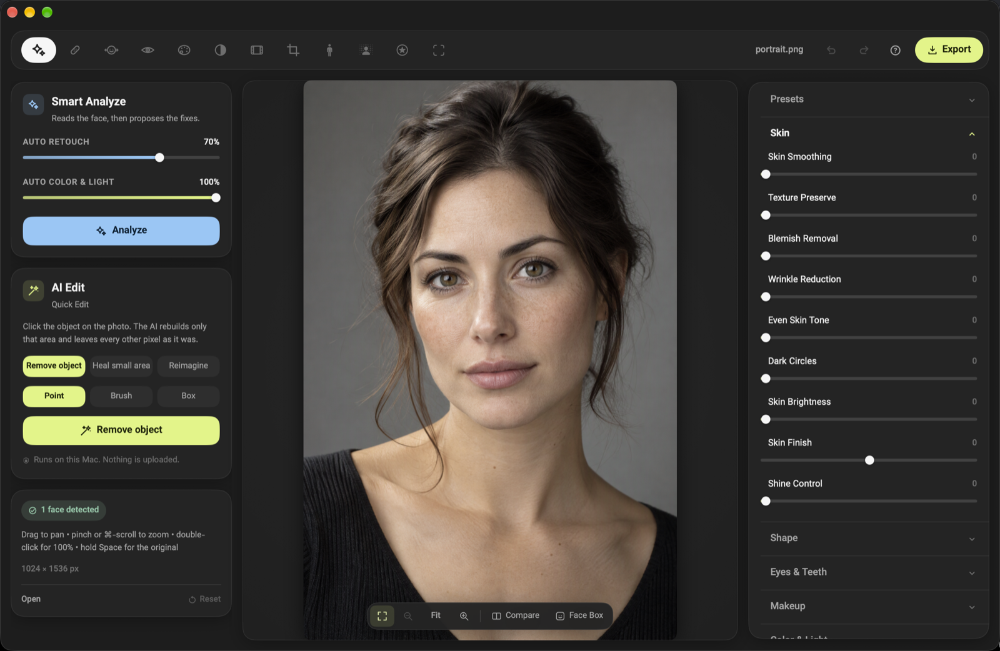
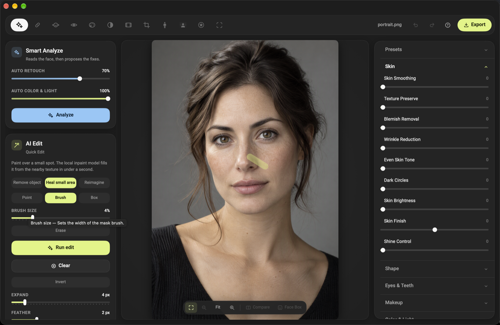
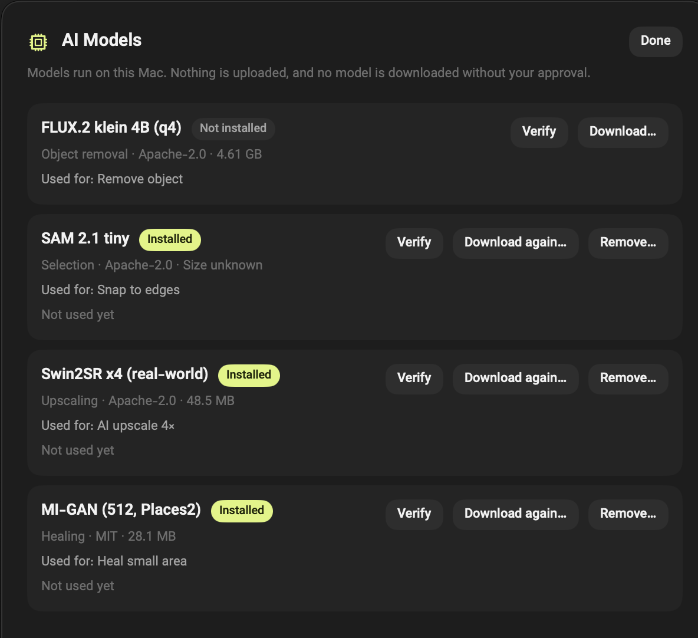

# Retouch Studio

**English** · [فارسی](README.fa.md)

A native macOS portrait-retouching studio with a bilingual English/Persian interface. Everything — analysis, retouching, masking, upscaling and export — runs on the machine. There is no cloud service, no account and no automatic upload.

Built with SwiftUI, Core Image and Vision, and shipped as a self-contained `.app` that does not need Xcode, Homebrew or a separate Python install.

## Highlights

- **Twelve tools in one inspector**: Skin, Healing, Reshape, Eyes & Teeth, Makeup, Color & Light, Looks, Crop, Body, Background, Stickers and Analysis.
- **Non-destructive edits**: every adjustment is a value in a project, so a saved `.retouch` file can be reopened and changed later. Up to 100 steps of undo and redo.
- **Automatic analysis** with a face overlay: skin, eyes, teeth and background are measured, and Auto Retouch only moves what the measurement justifies.
- **Optional local AI helper**: remove an object from a marked region, continue texture over a small area, reimagine the frame from a prompt, or upscale 4×. The models are downloaded on request; nothing is uploaded.
- **Project files and recovery**: `.retouch` projects, editable presets, and a debounced recovery copy while unsaved work exists.
- **Export control**: JPEG, PNG, TIFF or HEIC, long-edge cap, quality slider, watermark, optional face overlay, and GPS/camera identity stripped from the saved copy.
- **Bilingual UI**: complete English and Persian localisation (including Persian digits), switchable in Settings.
- **Hover help everywhere**: every tool, section, icon and slider explains itself in a tooltip.

## Screenshots



*Smart Analyze and AI Edit on the left, the before/after canvas, and the tool inspector on the right.*


*Marking a small area for the local inpainting model; brush size, expand and feather are adjustable.*



*Every control explains itself on hover — here the AI brush size.*



*The model manager lists size, licence and verification state; a download starts only after approval.*

The screenshots use an AI-generated fictional portrait. No personal photo is included in this repository.

## Requirements

- macOS 14 Sonoma or later on Apple silicon or Intel. Releases are published as separate Apple-silicon (arm64) and Intel (x86_64) disk images, plus a light universal zip archive.
- AI tools require Apple silicon, and the on-demand runtime download is not available in this build: the protocol-v2 installer stays disabled until an official runtime package is configured. The 1.0.0 runtime archive on the release page is not treated as a compatible protocol-v2 package; its compatibility has not been verified and the app will not install it. On Intel the editor, analysis and export work fully; the AI tools report that the runtime is unavailable.
- To run a release build: nothing else. The app is self-contained.
- To build from source: Xcode Command Line Tools (`xcode-select --install`). Xcode itself is not required; `build.sh` compiles directly with `swiftc`.

Windows is the planned second platform: the shared `StudioCore` module (document model, project codec, render contract and update policy) is Foundation-only, and its portability job runs on a native `windows-2025` GitHub runner, where the 260 core checks, the 86-check C ABI suite and the conformance gate pass. There is still no Windows renderer, UI or installer, so Windows is not a shipping target. Linux comes only after a verified Windows release candidate; the Linux `StudioCore` script is supplementary today and no Linux build is shipped.

## Run a release build

1. Download the disk image for this Mac — `RetouchStudio-1.0.0-arm64.dmg` for Apple silicon, `RetouchStudio-1.0.0-x86_64.dmg` for Intel — open it and drag `Retouch Studio.app` to Applications. The app is about 3.5–4 MB. The AI runtime download is disabled in this build, so the AI tools stay unavailable until an official protocol-v2 package is configured; model weights are downloaded separately once a helper runtime is available. A light universal zip archive is published beside the images for anyone who prefers one.
2. First launch: right-click the app and choose **Open**, or allow it under **System Settings → Privacy & Security → Open Anyway**. Release builds are ad-hoc signed and not notarized, so Gatekeeper asks once. See [`Docs/RELEASING.md`](Docs/RELEASING.md) for why and what comes next.

## Build from source

```bash
git clone <repository-url> RetouchStudio
cd RetouchStudio

./build.sh release                       # universal build, self-test, ad-hoc signature
open "Retouch Studio.app"
```

The default build is universal. A single-architecture build is available when the other slice is not needed:

```bash
RETOUCH_ARCH=arm64 ./build.sh release    # Apple silicon only
RETOUCH_ARCH=x86_64 ./build.sh release   # Intel only
```

A universal build runs the self-test natively and then again through the Intel slice (via Rosetta on an Apple-silicon build machine), so a release cannot ship an untested architecture.

The build copies the app into `Retouch Studio.app` in the repository root and stamps the version from `Resources/Info.plist`. A release build can override it without editing a source file:

```bash
RETOUCH_VERSION=1.0.0 RETOUCH_BUILD=1 ./build.sh release
```

Debug build (no optimisation):

```bash
./build.sh debug
```

Package the built app as a drag-to-Applications disk image (the name follows the built architecture):

```bash
RETOUCH_ARCH=arm64 RETOUCH_SKIP_WORKER=1 ./build.sh release
./Tools/make-dmg.sh                      # RetouchStudio-<version>-arm64.dmg + checksum

RETOUCH_ARCH=x86_64 RETOUCH_SKIP_WORKER=1 ./build.sh release
./Tools/make-dmg.sh                      # RetouchStudio-<version>-x86_64.dmg + checksum
```

The on-demand runtime archive is cut from a helper build, before the app is rebuilt without it:

```bash
RETOUCH_ARCH=arm64 ./build.sh release    # bundles Worker/ inside the app
./Tools/make-runtime.sh "Retouch Studio.app/Contents/Resources/Worker"
                                         # RetouchStudio-<version>-ai-runtime-arm64.zip + checksum
```

`make-runtime.sh` prints the byte count and SHA256 to keep in `AIRuntime.swift`; the app refuses an archive whose hash or size does not match. The current build still keeps `AIRuntime.package` nil, so this archive is not offered or installed until an official protocol-v2 package is approved and configured.

## The local AI helper is optional

The AI tools (remove object, heal area, reimagine, 4× upscale) run in a local Python worker. Release builds do not carry it. The protocol-v2 download path exists in the code but is disabled in this build (`AIRuntime.package` is nil) because no official runtime package has been approved: **Settings → Manage Models…** shows no runtime download, and the 1.0.0 arm64 archive is not treated as compatible. When an official package is configured, its consent sheet will show the archive name, its size and a 16-character SHA256 prefix; the app downloads it only after approval, verifies the full hash, and installs it under `~/Library/Application Support/RetouchStudio/AI/runtimes/protocol-v2`. Model weights stay under `~/Library/Application Support/RetouchStudio/AI/models` and are downloaded separately, each after a sheet shows the file count, total size and licence (the sheet does not list every file or its SHA256).

A build can also carry the helper inside the app, which copies a relocatable interpreter plus the required wheels into `Contents/Resources/Worker` (about 1.3–1.6 GB). Model weights are never bundled either way.

Without the helper the editor still runs; AI tools report that the runtime is unavailable. The helper is Apple-silicon-only, so an Intel Mac uses the editor without AI.

```bash
./build.sh release                                   # bundle the helper if it can be found
RETOUCH_WORKER_ROOT=/path/to/worker \
  RETOUCH_WORKER_VENV=/path/to/venv ./build.sh release   # point at a checkout explicitly
RETOUCH_SKIP_WORKER=1 ./build.sh release             # app only, helper skipped
```

At runtime the app prefers a helper packaged inside the app, then a downloaded protocol-v2 runtime under `AI/runtimes/protocol-v2`, then a source checkout found by walking up from the executable to a folder containing `worker/retouch_ai_worker`; `RETOUCH_AI_WORKER_ROOT` and `RETOUCH_AI_PYTHON` override that. Details, dependency versions and model licences are in [`Docs/AI_RUNTIME.md`](Docs/AI_RUNTIME.md).

## Tests

```bash
./Tests/run.sh
```

`Tests/run.sh` compiles the source tree with `swiftc` — every Swift file under `Sources/RetouchStudio` except `App.swift` and `SelfCheck.swift` — and runs four suites against real rendered pixels or real child processes:

- `EngineTests.swift` — the image pipeline, analysis, geometry, makeup, looks, export and mask behaviour.
- `ModelTests.swift` — project round-trips, presets, settings, localisation completeness and recovery.
- `RuntimeProcessTests.swift` — helper ownership, leases, runtime transactions and process lifecycle.
- `RuntimeV2Tests.swift` — the protocol-v2 registry, lock identity and recovery ordering.

`RETOUCH_ARCH=x86_64 ./Tests/run.sh` runs the same suites against an x86_64 build (through Rosetta on Apple silicon). Two opt-in harnesses sit beside it:

```bash
./Tests/run-corpus.sh        # golden image corpus, 376 checks, verifies baselines.json is unchanged
./Tests/run-benchmarks.sh    # deterministic 12/24/48 MP timings and memory; writes build/benchmarks/latest.json
```

The worker has its own Python suite (`unittest`); see `Docs/AI_RUNTIME.md`.

## Privacy

- Image analysis, editing, upscaling and export are entirely local; nothing is uploaded.
- When AI is used through a bundled helper or a future approved runtime package, the only network use is two explicit downloads: the optional AI runtime archive and the model weights. The owner approves the runtime after seeing its name, size and a 16-character SHA256 prefix, and approves each model after a sheet shows its file count, total size and licence. The runtime verifies its full SHA256 before installation; model checksums are verified where the catalog provides them (the SAM 2.1 tiny entry does not).
- The current build offers no runtime download. When enabled, the runtime is fetched once from this repository's release page; the app has no other outbound address, no telemetry and no background requests.
- GPS and camera identity are removed from exported copies.
- No telemetry, no analytics, no crash reporting service.

The measured inventory — frameworks, sockets, download consent and the runtime sampling method — is in [`Docs/PRIVACY_AUDIT.md`](Docs/PRIVACY_AUDIT.md).

## Project layout

```
Sources/StudioCore/     portable Foundation-only core: documents, codec, render contract, update rules
Sources/RetouchStudio/
  App.swift            app entry point and menus
  Core/                rendering engines, analysis, export, AI helper client, updater
  Models/              projects, settings, localisation, presets, model manager
  Views/               editor, inspector, tool panels, overlays, settings
Resources/             Info.plist, app icon, Vazir fonts (OFL)
Tests/                 engine, model, runtime and corpus suites, benchmarks, run.sh
Tools/                 bundle-worker.sh (optional Python runtime), make-dmg.sh, make-runtime.sh
Docs/                  AI runtime, privacy audit, technical audit, benchmarks, release notes
build.sh               compile + assemble + sign + self-test
```

## Documentation

| Document | Contents |
|---|---|
| [`Docs/AI_RUNTIME.md`](Docs/AI_RUNTIME.md) | Helper architecture, dependencies, model catalogue and licences |
| [`Docs/PRIVACY_AUDIT.md`](Docs/PRIVACY_AUDIT.md) | Network inventory and consent model |
| [`Docs/PHASE5_ACCEPTANCE.md`](Docs/PHASE5_ACCEPTANCE.md) | What was verified for the packaged AI runtime |
| [`Docs/TECHNICAL_AUDIT.md`](Docs/TECHNICAL_AUDIT.md) | Engine and UI audit findings |
| [`Docs/STABILIZATION_PLAN.md`](Docs/STABILIZATION_PLAN.md) | Stabilization scope and acceptance criteria |
| [`Docs/RELEASING.md`](Docs/RELEASING.md) | Versioning, signing, packaging and publishing checklist |
| [`Docs/UPDATE_SYSTEM.md`](Docs/UPDATE_SYSTEM.md) | Signed manifest, key handling, atomic swap and recovery; no public feed yet |
| [`Docs/PERFORMANCE_BENCHMARKS.md`](Docs/PERFORMANCE_BENCHMARKS.md) | Measured load, preview, analysis, mask, export, batch and memory numbers |
| [`Docs/GOLDEN_IMAGE_CORPUS.md`](Docs/GOLDEN_IMAGE_CORPUS.md) | The 12-fixture corpus, its baseline lock and provenance checks |
| [`Docs/CROSS_PLATFORM_TECHNOLOGY_DECISIONS.md`](Docs/CROSS_PLATFORM_TECHNOLOGY_DECISIONS.md) | The portable/ macOS boundary and the Windows path |
| [`Docs/RELEASE_NOTES_1.0.0.md`](Docs/RELEASE_NOTES_1.0.0.md) | Release notes for the first public build |

## License

MIT — see [`LICENSE`](LICENSE). The bundled Vazir typeface is distributed under the SIL Open Font License (see `Resources/Fonts/OFL.txt`). Model weights are downloaded by the user and carry their own licences, listed in `Docs/AI_RUNTIME.md`.
